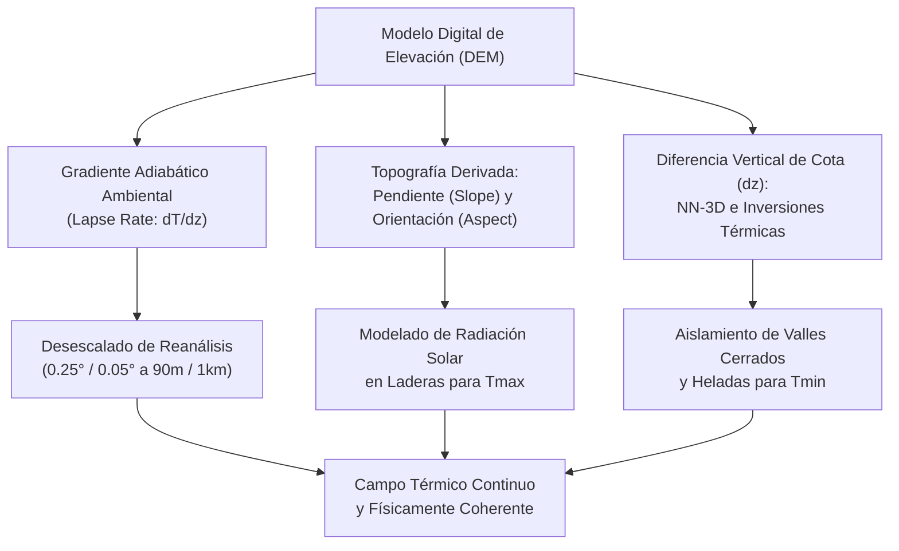
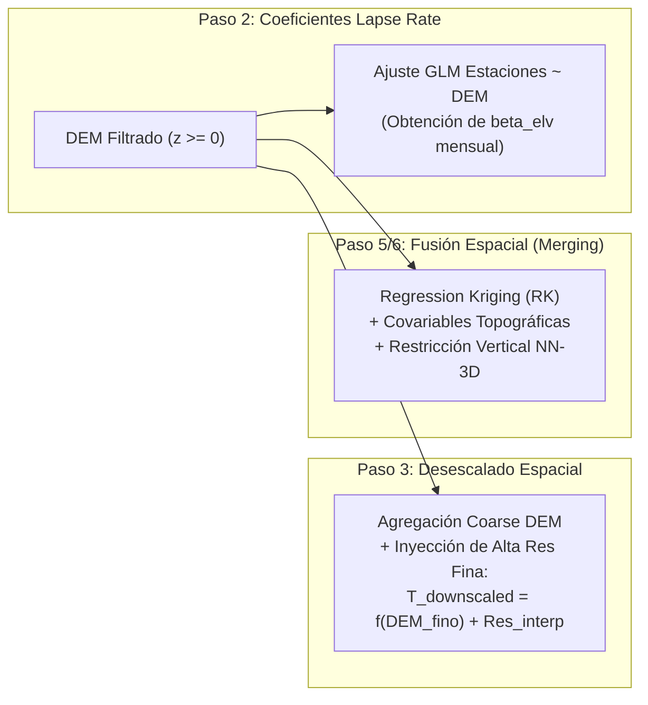

# 05. Fusión de Temperatura (Temperature Data) y Modelado Topográfico

## 1. Características del Campo de Temperatura

A diferencia de la precipitación, la temperatura (máxima, mínima o media) es un campo biofísico caracterizado por:
1. **Continuidad espacial estricta:** No presenta ceros estructurales ni las discontinuidades abruptas típicas de la lluvia convectiva.
2. **Dominancia orográfica de primer orden:** El factor preponderante en la distribución espacial de la temperatura superficial es la **altitud topográfica**, gobernada por la descompresión adiabática y el gradiente térmico vertical (*lapse rate*, con valores medios de $-5.0$ a $-6.5\ ^\circ\text{C}$ por cada $1000\text{ m}$ de elevación en la troposfera baja tropical).
3. **Efectos de microclima y exposición radiativa:** La orientación (*aspect*) y la pendiente (*slope*) modulan la radiación solar incidente (insolación matutina vs. vespertina), influyendo con fuerza en la temperatura máxima ($T_{\max}$).
4. **Desacoples térmicos locales nocturnos:** El enfriamiento radiativo en noches despejadas produce drenaje catabático de aire frío hacia cuencas y fondos de valle (*cold-air pooling*), generando inversiones térmicas nocturnas donde valles altos amanecen bajo cero mientras las crestas circundantes se mantienen más templadas, factor crucial en la temperatura mínima ($T_{\min}$).
5. **Gradiente latitudinal / continental:** Atenuación sinóptica de la temperatura explicada por la cercanía a las masas oceánicas y la latitud geográfica.

Por estas razones físicas, la fusión de temperatura en CDT depende críticamente de un **Modelo Digital de Elevación (DEM)** de alta fidelidad, utilizándolo como covariable determinística tanto en la fase previa de desescalado (*downscaling*) como en la fusión geoestadística mediante **Regression Kriging (`"RK"`)**.

---

## 2. Influencia Fisiográfica y Termodinámica del DEM en la Temperatura

El Modelo Digital de Elevación (DEM) actúa como la columna vertebral física que ancla las observaciones térmicas gruesas de satélites o reanálisis a la realidad del terreno:



### 2.1. Gradiente Térmico Vertical Ambiental (*Environmental Lapse Rate*)
En la troposfera tropical, la masa atmosférica disminuye exponencialmente con la altura, reduciendo la presión barométrica. Una parcela de aire que asciende se expande adiabáticamente y se enfría:
$$\frac{\partial T}{\partial z} \approx -6.5\ ^\circ\text{C}/\text{km}$$
Sin un DEM que proporcione la cota precisa $z$, cualquier interpolación espacial generaría manchas isotérmicas ficticias entre estaciones separadas por pocos kilómetros pero ubicadas en distintas altitudes (por ejemplo, una estación costera a $10\text{ msnm}$ con $32\ ^\circ\text{C}$ frente a una estación de montaña a $2000\text{ msnm}$ con $16\ ^\circ\text{C}$). El DEM permite descomponer el campo térmico en un componente determinístico altimétrico y un residuo estocástico sinóptico.

### 2.2. Efectos de Pendiente e Insolación (*Slope* y *Aspect*)
La insolación neta que calienta el suelo depende del ángulo cenital solar relativo a la normal de la ladera:
- Las laderas orientadas al este reciben radiación directa en horas de la mañana con temperaturas ambiente bajas.
- Las laderas orientadas al oeste reciben máxima insolación en horas vespertinas cuando el aire ya ha acumulado calor sensible, alcanzando picos extremos de $T_{\max}$.
- Los cañones profundos experimentan sombreado topográfico temprano.
CDT deriva automáticamente `Slope` y `Aspect` a partir de la malla del DEM mediante derivadas espaciales de segundo orden ($\partial z / \partial x, \partial z / \partial y$), utilizándolas como predictores lineales en el modelo de regresión.

### 2.3. Drenaje Catabático e Inversiones Térmicas Nocturnas
Durante la noche, el enfriamiento radiativo superficial vuelve el aire en contacto con el suelo más denso que el aire libre. La gravedad hace que este flujo fluya ladera abajo (*drainage winds*) y se estanque en cuencas intramontanas cerradas. En estas condiciones:
$$\frac{\partial T}{\partial z} > 0 \quad (\text{en la capa límite superficial del valle})$$
Para capturar este fenómeno en $T_{\min}$, el parámetro de distancia tridimensional (`NN-3D`) utiliza el DEM para penalizar la cercanía horizontal si existe un salto vertical sustancial ($\Delta z$), evitando que estaciones cálidas en valles bajos contaminen la interpolación de valles fríos de montaña.

---

## 3. Rol Crítico del DEM en Cada Etapa del Flujo de CDT

En el flujo integral de temperatura (guía metodológica y menú de CDT), el DEM no es un insumo pasivo; interviene activamente en **cuatro de los cinco pasos principales**:



### Paso A: Modelado del Coeficiente de Desescalado (Lapse Rate Mensual)
En `R/cdtTemp_DownscalingCoef_Procs.R`, CDT extrae la elevación del DEM en cada estación meteorológica y ajusta un modelo lineal mensual:
$$\text{Temp}_m(s_i) = \beta_{0,m} + \beta_{\text{elv},m} \cdot \text{DEM}(s_i) + \sum \beta_{k,m} X_k(s_i) + \varepsilon(s_i)$$
El coeficiente $\beta_{\text{elv},m}$ debe ser **negativo** ($\approx -0.0055$ a $-0.0065\ ^\circ\text{C}/\text{m}$), reflejando que a mayor altitud, menor temperatura.

### Paso B: Reducción de Escala (Downscaling de Grillas a Resolución del DEM)
En `R/cdtTemp_DownscalingReanal_Procs.R`, CDT ejecuta:
1. Agregación de la malla fina del DEM a la malla gruesa del reanálisis/satélite: $\text{DEM}_{\text{coarse}}$.
2. Cálculo de la temperatura esperada por topografía gruesa: $\hat{T}_{\text{coarse}} = \beta_0 + \beta_{\text{elv}} \cdot \text{DEM}_{\text{coarse}}$.
3. Extracción del residual sinóptico grueso: $R_{\text{coarse}} = T_{\text{sat}} - \hat{T}_{\text{coarse}}$.
4. Interpolación espacial del residual a la malla fina del DEM: $\hat{R}_{\text{fine}}$.
5. Reconstrucción física de alta resolución:
   $$T_{\text{downscaled}}(s_{\text{fine}}) = \beta_0 + \beta_{\text{elv}} \cdot \text{DEM}_{\text{fine}}(s_{\text{fine}}) + \hat{R}_{\text{fine}}(s_{\text{fine}})$$

> [!IMPORTANT]
> Observa que si el valor de $\text{DEM}_{\text{fine}}$ o el coeficiente $\beta_{\text{elv}}$ están distorsionados, toda la temperatura de alta resolución colapsará inmediatamente antes de llegar a la fase de fusión.

### Paso C: Fusión Espacial Final (Regression Kriging)
En `R/cdtMerging_Temp_Cmd.R`, CDT utiliza el DEM como covariable base de la tendencia espacial diaria. Las estaciones terrestres se ajustan contra el valor puntual del DEM, y la superficie estimada se calcula evaluando el polinomio de regresión en toda la grilla del DEM antes de sumar los residuos krigeados.

---

## 4. Patología Climatológica: Impacto de la Batimetría Submarina y Valores Negativos

Durante la fase experimental de temperatura en Centroamérica, se identificó un problema técnico crítico que ilustra la sensibilidad matemática del algoritmo:

### 4.1. Diagnóstico del Error por Batimetría Oceánica
Al suministrar un producto global sin procesar como **GEBCO** (`gebco_2026.nc`), el archivo contiene tanto la topografía continental positiva ($z > 0\text{ msnm}$) como la **batimetría del lecho marino** ($z < 0\text{ msnm}$, con profundidades de hasta $-8390\text{ m}$ en fosas abisales del Pacífico y del Caribe):

| Parámetro Topográfico | Archivo Crudo (GEBCO con Batimetría) | Archivo Terrestre Clampeado a Nivel del Mar |
| :--- | :--- | :--- |
| **Elevación Mínima ($z_{\min}$)** | $-8390.0\text{ m}$ (Fosa marina) | $0.0\text{ m}$ (Nivel medio del mar) |
| **Elevación Máxima ($z_{\max}$)** | $+5611.0\text{ m}$ (Cumbre montañosa) | $+5611.0\text{ m}$ (Cumbre montañosa) |
| **Media Regional del DEM** | **$-1708.05\text{ m}$** (Ficticia, océano profundo) | $+350.20\text{ m}$ (Real continental) |
| **Porcentaje de Malla con $z < 0$** | $\approx 68\%$ del dominio centroamericano | $0\%$ (Todo el mar a $0\text{ msnm}$) |

### 4.2. Colapso Matemático del Gradiente Térmico
Cuando CDT calcula el *Lapse Rate* (Paso 2) o la regresión espacial con un DEM batimétrico:
1. En la agregación gruesa ($\text{DEM}_{\text{coarse}}$), los píxeles costeros promedian la tierra ($+500\text{ m}$) con fosas abisales ($-3000\text{ m}$), resultando en elevaciones ficticias de $-1250\text{ m}$.
2. En el GLM, la correlación entre la temperatura observada ($15$ a $32\ ^\circ\text{C}$) y elevaciones que varían entre $-8390\text{ m}$ y $+4000\text{ m}$ se distorsiona completamente, produciendo coeficientes **positivos** espurios ($\beta_{\text{elv}} \approx +0.017\ ^\circ\text{C}/\text{m}$) o interceptos absurdos ($\beta_0 \approx -10\ ^\circ\text{C}$).
3. Al aplicar la reconstrucción:
   $$T_{\text{downscaled}} = \beta_0 + \beta_{\text{elv}} \cdot \text{DEM}_{\text{fino}} + \hat{R}$$
   la topografía continental real positiva ($+1000$ a $+3000\text{ m}$) resta masivamente temperatura o sobre-corrige los residuales, desplomando las temperaturas en tierra a valores inverosímiles ($-10\ ^\circ\text{C}$ a $5\ ^\circ\text{C}$ en costas tropicales).
4. **Consecuencia en Validación:** Las métricas se colapsan a $RMSE > 25\ ^\circ\text{C}$, $PBIAS < -60\%$ y $KGE < -10$, haciendo que los experimentos con DEM parezcan inferiores a un control nulo sin topografía (`EXP_TX01` / `EXP_TN01`).

```mermaid
graph TD
    subgraph DEM_Corrupto["DEM con Batimetría Submarina (-8390 m a +5600 m)"]
        A1["Océano con z < 0<br>(Media regional = -1708 m)"] --> B1["Agregación Coarse mezcla<br>tierra positiva y fosas marinas"]
        B1 --> C1["GLM invierte el signo:<br>beta_elv = +0.017 °C/m (Positivo espurio)"]
        C1 --> D1["Reconstrucción térmica resta decenas de grados en tierra"]
        D1 --> E1["Colapso: RMSE = 24-42 °C, KGE < -10"]
    end
    
    subgraph DEM_Corregido["DEM Clampeado a Nivel del Mar (0 m a +5600 m)"]
        A2["Océano plano z = 0 msnm<br>(Tierra z: 0 a 4200 m)"] --> B2["Agregación Coarse y Fina<br>termodinámicamente coherentes"]
        B2 --> C2["GLM ajusta Lapse Rate real:<br>beta_elv = -0.0055 a -0.0065 °C/m"]
        C2 --> D2["Reconstrucción térmica reproduce gradientes adiabáticos"]
        D2 --> E2["Óptimo: RMSE < 2.5 °C, KGE > 0.85"]
    end
```



---

## 5. Estrategia Óptima: Clampeo a Cero (`elevation < 0 = 0`) y Preservación Insular

Para solucionar este fenómeno, la mejor práctica climatológica y geoespacial consiste en aplicar un **clampeo de elevación al nivel del mar** combinado con un recorte (*bounding box*) regional:

$$\text{DEM}_{\text{clean}}(x, y) = \max\left(\text{DEM}(x, y), \, 0.0\right)$$

### 5.1. ¿Por qué el Clampeo a Cero es Superior al Recorte Vectorial por Polígono de Tierra?

1. **Sentido Físico de Nivel del Mar:** La atmósfera en contacto con el océano descansa sobre una superficie de agua a **$0\text{ metros sobre el nivel medio del mar}$**. Tratar el océano como una llanura térmica horizontal a $0\text{ msnm}$ refleja con exactitud la frontera termodinámica inferior de la atmósfera.
2. **Preservación Total de Islas y Cayos:**
   - En la región existen numerosas estaciones e intereses climatológicos en islas: por ejemplo `HO_Roatan` (Islas de la Bahía de Honduras, $14\text{ msnm}$), Isla de Guanaja, Utila, Isla de Ometepe (Nicaragua), Isla de Coiba y Archipiélago de las Perlas (Panamá), Cayos Miskitos y cayos litorales.
   - Si se intentara recortar (*mask*) el DEM con un shapefile vectorial continental estricto, las discrepancias de escala y resolución entre los vértices del polígono y la malla del ráster inevitablemente convertirían los píxeles insulares en valores ausentes (`NA`), descartando las estaciones insulares o impidiendo generar estimaciones sobre ellas.
   - Al clampear $\text{elevación} = \max(\text{elevación}, 0.0)$, **todas las islas retienen su cota real positiva ($z > 0\text{ msnm}$)**, integrándose perfectamente en el modelo orográfico.
3. **Eliminación de Discontinuidades y Valores Faltantes en Bordes Costeros:**
   - Las rutinas de CDT (`defSpatialPixels`, `interp.surface.grid`, Ordinary Kriging e IDW) requieren matrices regulares continuas.
   - Si las celdas marinas fueran `NA`, las estaciones costeras situadas en el borde continental generarían fallas numéricas en el cálculo de variogramas y en la búsqueda de vecinos espaciales hacia el mar.
   - Al tener una superficie marina continua en $0\text{ msnm}$, la interpolación de residuales transcurre de forma continua, suave y sin singularidades de matriz.

---

## 6. Configuración de Parámetros para Temperatura en `cdtMergingTempCMD`

La llamada estándar en la terminal o script de producción se estructura de la siguiente manera:

```r
cdtMergingTempCMD(
  time.step = "daily",
  dates = list(from = "range", pars = list(start = "19910101", end = "20201231")),
  station.data = list(file = "data/stations/tmax_stations_ca.csv", sep = ",", na.strings = "-99"),
  netcdf.data = list(
    dir = "data/chirts_bias_corrected/tmax", 
    format = "tmax_%s%s%s.nc",
    varid = "temp", 
    ilon = 1, 
    ilat = 2
  ),
  merge.method = list(
    method = "RK",               # Regression Kriging
    nrun = 3, 
    pass = c(1, 0.75, 0.5)
  ),
  interp.method = list(
    method = "idw",              # o "okr" si hay densidad de estaciones
    nmin = 8, 
    nmax = 24, 
    maxdist = 3.5,               # Radio amplio (3.5°) para masas térmicas
    use.block = TRUE, 
    vargrd = FALSE
  ),
  auxvar = list(
    dem = TRUE,                  # Elevación DEM requerida
    slope = TRUE,                # Pendiente derivada del DEM
    aspect = FALSE,              # Orientación (activar en Tmax para radiación)
    lon = TRUE,                  # Longitud
    lat = TRUE                   # Latitud
  ),
  dem.data = list(
    file = "data/topography/dem_ca_continental_land.nc", # DEM limpio sin batimetría
    varid = "elevation", 
    ilon = 1, 
    ilat = 2
  ),
  grid = list(from = "data", pars = NULL),
  output = list(dir = "output/tmax_merged", format = "tmax_mrg_%s%s%s.nc"),
  GUI = FALSE
)
```

---

## 7. Modelado Estadístico por Regresión (GLM en RK)

Para cada fecha diaria $t$, CDT ajusta un Modelo Lineal Generalizado de la familia Gaussiana con las estaciones disponibles:

$$\text{Temp}(s_i) = \beta_0 + \beta_1 \cdot \text{Reanalysis}(s_i) + \beta_2 \cdot \text{DEM}(s_i) + \beta_3 \cdot \text{Slope}(s_i) + \beta_4 \cdot \text{Lon}(s_i) + \beta_5 \cdot \text{Lat}(s_i) + \varepsilon(s_i)$$

1. **Derivación topográfica automática:**
   Si `slope = TRUE` o `aspect = TRUE`, CDT calcula internamente las matrices de pendiente y orientación a partir del archivo NetCDF del DEM mediante la función interna `raster.slope.aspect()`.
2. **Evaluación de la tendencia espacial:**
   Se evalúa la ecuación ajustada en toda la malla de alta resolución del DEM:

   $$\text{Trend}(s) = \hat{\beta}_0 + \hat{\beta}_1 \text{Reanalysis}(s) + \hat{\beta}_2 \text{DEM}(s) + \hat{\beta}_3 \text{Slope}(s) + \hat{\beta}_4 \text{Lon}(s) + \hat{\beta}_5 \text{Lat}(s)$$

3. **Interpolación de residuales térmicos:**
   Los residuales no explicados por la topografía ni por el reanálisis ($\varepsilon_i = \text{Obs}_i - \text{Trend}_i$) representan anomalías locales (inversiones térmicas en valles, brisas costeras, islas de calor urbano) y se interpolan hacia toda la malla con el método seleccionado (`idw` u `okr`).

---

## 8. Límites Físicos y Control de Calidad

- **Límites de temperatura en CDT:** $[-40\ ^\circ\text{C}, +50\ ^\circ\text{C}]$.
- En el caso de variables derivadas (presión atmosférica, humedad relativa), CDT ajusta los rangos correspondientes:
  - Humedad Relativa (`"rh"`): $[0, 100]\%$.
  - Presión Superficial (`"pres"`): $[700, 1100]\text{ hPa}$.
  - Presión a Nivel del Mar (`"prmsl"`): $[850, 1100]\text{ hPa}$.
  - Radiación (`"rad"`): $[0, 1300]\text{ W/m}^2$.
