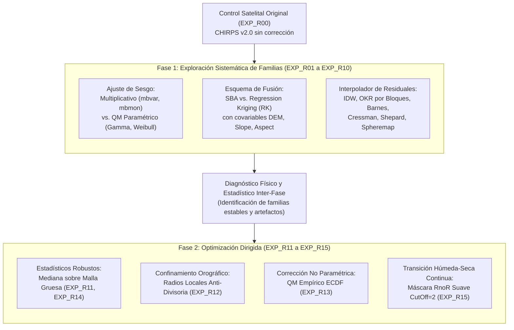

# 09. Diseño Experimental en Dos Fases y Criterios Climatológicos para Precipitación Diaria

> **Componente de Validación:** Suite A — Precipitación Diaria (`rainfall`, CHIRPS v2.0 + Pluviómetros NMHS)  
> **Período de Reconstrucción:** 1991–2020 (30 años continuos, 10,958 días)  
> **Configuraciones Evaluadas:** 16 configuraciones (Control Satelital `EXP_R00` + 10 Experimentos de Fase 1 + 5 Experimentos de Fase 2)

Este documento describe la arquitectura metodológica en **dos fases experimentales** implementada para la fusión espacial de precipitación diaria en **Climate Data Tools (CDT v8.0)**, las hipótesis hidroclimáticas asociadas a cada configuración y los criterios climatológicos que complementan la validación estadística puntual.

---

## 1. Esquema de Validación Cruzada Independiente (*Holdout*)

Para garantizar una evaluación objetiva libre de sobreajuste espacial (*overfitting*), el flujo de trabajo separa estrictamente la red de estaciones antes de ejecutar cualquier etapa de CDT:

- **Conjunto de Entrenamiento (*Training Set*):** Subconjunto mayoritario de estaciones (~85–90% de la red) ingresado a las tres etapas de CDT:
  1. Cálculo de coeficientes o funciones de distribución de sesgo (`cdtBiasCoeffRainCMD`).
  2. Aplicación de la corrección de sesgo sobre la serie satelital CHIRPS (`cdtBiasCorrectRainCMD`).
  3. Interpolación de residuales y máscara húmeda-seca *Rain-No-Rain* (`cdtMergingRainCMD`).
- **Conjunto de Validación Ciega (*Holdout Set*):** Subconjunto independiente (~10–15% de la red, estratificado por zona climática y piso altitudinal) completamente excluido de los archivos de entrada de CDT mediante [`launcher/station_manager.py`](../launcher/station_manager.py).
- **Control Satelital Original (`EXP_R00_Raw_CHIRPS`):** Evaluación directa de la rejilla satelital original CHIRPS v2.0 ($0.05^\circ$) sobre las mismas coordenadas del conjunto *holdout*, estableciendo la referencia base sin intervención geoestadística.

---

## 2. Estructura Metodológica en Dos Fases Experimentales

Dada la alta variabilidad espacio-temporal de la precipitación diaria en regímenes tropicales complejos —donde coexisten convección profunda localizada, ascenso orográfico por vientos alisios, sistemas frontales (*Nortes*) y subsidencia en valles intramontanos—, la búsqueda de parametrizaciones óptimas se divide en **dos fases secuenciales**:

---

## 3. Fase 1: Exploración Sistemática de Familias Geoestadísticas (10 Experimentos)

La **Fase 1 (`EXP_R01` a `EXP_R10`)** explora de manera ortogonal las tres decisiones estructurales del flujo de fusión de precipitación en CDT:

1. **Mecanismo de Corrección de Sesgo (Pasos 1 y 2):**
   - **Sesgo Multiplicativo Móvil (`mbvar`) o Mensual (`mbmon`):** Ajusta la razón media observada/satelital en ventanas móviles decádicas ($\pm 5\text{ días}$) o climatológicas mensuales, preservando la estructura temporal de eventos diarios.
   - **Mapeo de Cuantiles Paramétrico (`qmdist`):** Ajusta distribuciones mixtas Bernoulli-Gamma (`berngamma`) o Bernoulli-Weibull (`bernweibull`) para transformar conjuntamente la probabilidad de ocurrencia y la cola de intensidades.
2. **Estrategia de Fusión (Paso 3):**
   - **Simple Bias Adjustment (`SBA`):** Interpola directamente los residuales entre los pluviómetros y el fondo satelital corregido.
   - **Regression Kriging (`RK`):** Modela una tendencia determinista explícita en función de covariables fisiográficas derivadas del DEM ($z$, pendiente $\text{Slope}$ y orientación $\text{Aspect}$) antes de interpolar los residuales estocásticos.
3. **Algoritmo de Interpolación Espacial y Máscara *Rain-No-Rain* (`RnoR`):**
   - Evalúa interpoladores deterministas isotrópicos (`IDW`), esquemas de corrección sucesiva (`Barnes`, `Cressman`), ponderación direccional angular (`Modified Shepard`, `Spheremap`) y geoestadística variográfica (`Ordinary Kriging` por bloques), con y sin máscara logística `RnoR`.

### Matriz de Hipótesis de la Fase 1 (`EXP_R01` a `EXP_R10`)

| ID Exp. | Familia de Sesgo | Estrategia de Fusión | Interpolador y Radios | Máscara RnoR | Hipótesis Hidroclimática Evaluada |
| :---: | :--- | :--- | :--- | :---: | :--- |
| **`EXP_R01`** | `mbvar` ($\pm 5\text{ d}$) + IDW | `SBA` Monocapa | IDW plano (1 pasada, $1.5^\circ$) | Desactivada | **Línea Base 2D:** Evalúa la capacidad de una interpolación isotrópica simple sin control de áreas secas. |
| **`EXP_R02`** | `mbvar` ($\pm 5\text{ d}$) + IDW | `SBA` Multiescala | IDW (3 pasadas: $1.5^\circ \to 0.5^\circ$) | Rígida (`CutOff=1`) | **Control Húmedo-Seco Binario:** Prueba la reducción de falsas alarmas mediante truncamiento logístico abrupto. |
| **`EXP_R03`** | `qmdist` Bernoulli-Gamma | `SBA` Multiescala | Kriging Ordinario (`OKR`) por bloques | Rígida (`CutOff=1`) | **QM Paramétrico Gamma:** Evalúa el ajuste teórico de sesgo e intensidad acoplado a semivariogramas diarios. |
| **`EXP_R04`** | `qmdist` Bernoulli-Weibull | `SBA` Multiescala | Kriging Ordinario (`OKR`) por bloques | Rígida (`CutOff=1`) | **QM Paramétrico Weibull:** Prueba una cola pesada alternativa para regímenes convectivos intensos. |
| **`EXP_R05`** | `qmdist` Bernoulli-Weibull | `RK` (DEM + Slope + Coords) | Kriging Ordinario (`OKR`) por bloques | Rígida (`CutOff=1`) | **Forzamiento Orográfico Lineal:** Hipótesis de proporcionalidad directa entre altitud, pendiente y lluvia diaria. |
| **`EXP_R06`** | `mbvar` ($\pm 5\text{ d}$) + NN-3D | `SBA` Multiescala | **Barnes (`BSc`)** 3 pasadas gaussianas | Rígida (`CutOff=1`) | **Filtro Gaussiano Costero:** Amortiguamiento suave de gradientes litorales y brisas marinas. |
| **`EXP_R07`** | `mbmon` (mensual) + IDW | `SBA` Multiescala | **Cressman (`CSc`)** 4 pasadas ($1.0^\circ \to 0.25^\circ$) | Rígida (`CutOff=1`) | **Configuración Guía Oficial CDT:** Convergencia sucesiva hacia núcleos convectivos de mesoescala. |
| **`EXP_R08`** | `mbvar` ($\pm 5\text{ d}$) + IDW | `SBA` Multiescala | **Shepard Modificado** ($1.5^\circ$) | Rígida (`CutOff=1`) | **Desagrupamiento Angular:** Penalización de estaciones redundantes y derivadas direccionales de Taylor. |
| **`EXP_R09`** | `mbvar` ($\pm 5\text{ d}$) + IDW | `SBA` Multiescala | **Spheremap** (Gran Círculo, $1.5^\circ$) | Rígida (`CutOff=1`) | **Geometría Esférica:** Cálculo geodésico exacto de distancias y ángulos sobre el elipsoide. |
| **`EXP_R10`** | `qmdist` Bernoulli-Gamma | `RK` Total (DEM+Slope+Aspect) | Kriging Ordinario (`OKR`) por bloques | Rígida (`CutOff=1`) | **Máxima Complejidad Fisiográfica:** Acoplamiento simultáneo de altitud, pendiente y exposición barlovento/sotavento. |

---

## 4. Fase 2: Optimización Física y Estadística Dirigida (5 Experimentos)

La **Fase 2 (`EXP_R11` a `EXP_R15`)** se diseña para aislar y resolver cuatro limitaciones estructurales específicas del modelado de precipitación diaria:

1. **Sensibilidad del Sesgo Multiplicativo a Tormentas Convectivas Aisladas (`EXP_R11` y `EXP_R14`):**
   - Sustituye el estimador de la media muestral por la **mediana robusta** (`fun: "median"`) evaluada sobre una malla gruesa agregada (`coarse.grid: TRUE`, $1.0^\circ$), evitando que un único evento convectivo extremo distorsione el factor multiplicativo decádico.
2. **Contaminación Trans-Divisoria entre Vertientes Climáticas (`EXP_R12`):**
   - Reduce el radio de búsqueda de Shepard Modificado a un entorno estrictamente local ($0.9^\circ \approx 100\text{ km}$), impidiendo que anomalías húmedas de la vertiente caribeña se propaguen a través de la cordillera hacia los valles secos del Pacífico (y viceversa).
3. **Rigidez de las Distribuciones Paramétricas Teóricas (`EXP_R13`):**
   - Sustituye las familias paramétricas Gamma/Weibull por **Mapeo de Cuantiles Empírico No-Paramétrico (`qmecdf`)**, construyendo funciones de distribución acumulada empíricas directamente a partir de las series históricas.
4. **Discontinuidad Espacial de la Máscara *Rain-No-Rain* Binaria (`EXP_R15`):**
   - Reemplaza el umbral escalonado rígido (`RnoRCutOff = 1`) por un esquema de **transición continua suave (`RnoRCutOff = 2`, `wet.day = 0.5 mm`, `smooth = TRUE`)**, permitiendo una amortiguación gradual en los bordes de las celdas convectivas.

### Matriz de Hipótesis de la Fase 2 (`EXP_R11` a `EXP_R15`)

| ID Exp. | Configuración de Sesgo (Paso 1) | Interpolador de Fusión (Paso 3) | Parámetros Diferenciadores de Fase 2 | Hipótesis de Optimización |
| :---: | :--- | :--- | :--- | :--- |
| **`EXP_R11`** | `mbvar` ($\pm 5\text{ d}$) + **Mediana** + Malla Gruesa ($1.0^\circ$) | Shepard Modificado ($1.5^\circ$) + Malla Gruesa | `fun: "median"`, `coarse.grid: TRUE`, `RnoRCutOff: 1` | **Estabilidad de Extremos:** Neutraliza valores atípicos convectivos en el cálculo del factor multiplicativo. |
| **`EXP_R12`** | `mbvar` ($\pm 5\text{ d}$) + Media + IDW ($1.0^\circ$) | Shepard Confinado Local ($0.9^\circ$, 3 pasadas) | `maxdist: 0.9`, `nmin: 3`, `nmax: 10`, `RnoRCutOff: 1` | **Aislamiento de Vertientes:** Evita el cruce de residuales pluviales sobre divisorias continentales estrechas. |
| **`EXP_R13`** | **QM Empírico (`qmecdf`)** + Shepard ($1.5^\circ$) | Shepard Modificado ($1.5^\circ$) | `bias.method: "qmecdf"`, `RnoRCutOff: 1` | **Flexibilidad No Paramétrica:** Elimina el supuesto de forma funcional fija en las colas de precipitación. |
| **`EXP_R14`** | `mbvar` ($\pm 5\text{ d}$) + **Mediana** + Spheremap ($1.5^\circ$) | Spheremap Gran Círculo ($1.5^\circ$) | `interp.method: "spheremap"`, `fun: "median"` | **Geodésica Robusta:** Combina trigonometría esférica de gran círculo con estimación robusta de mediana. |
| **`EXP_R15`** | `mbvar` ($\pm 5\text{ d}$) + Media + IDW ($1.2^\circ$) | Shepard Modificado ($1.2^\circ$) + **RnoR Suave** | `RnoRCutOff: 2`, `wet.day: 0.5`, `smooth: TRUE` | **Continuidad de Bordes Pluviales:** Suprime el efecto *drizzle* satelital sin amputar la lámina de lluvias débiles a moderadas. |

---

## 5. Criterios de Admisibilidad Climatológica

La selección de configuraciones óptimas para generación de escenarios climáticos no puede descansar exclusivamente en la clasificación ciega de una métrica puntual, sino que debe satisfacer tres criterios de consistencia física respaldados por la literatura hidroclimática:

### 5.1 Prevención de Artefactos de «Ojos de Buey» (*Bull's-Eye Artifacts*)
Los interpoladores puramente isotrópicos de distancia inversa ($\text{IDW}$, como en `EXP_R01` y `EXP_R02`) asignan pesos exclusivamente en función de la distancia euclidiana $w_i = d_i^{-p}$, presentando dos deficiencias estructurales ampliamente documentadas (Shepard, 1968; Daly, 2006; Hofstra et al., 2008):
1. **Singularidad de derivada nula ($\nabla \hat{Z}(\mathbf{s}_i) = \mathbf{0}$) en cada estación:** Genera máximos y mínimos circulares concéntricos alrededor de pluviómetros aislados (*ojos de buey*), mientras el campo inter-estación decae artificialmente hacia el promedio de fondo.
2. **Ausencia de desagrupamiento direccional (*declustering*):** Un racimo de estaciones en un valle intramontano domina aritméticamente la interpolación sobre una ladera adyacente con menor densidad de muestreo.

En contraste, los esquemas de ** ponderación angular direccional** (`Modified Shepard` y `Spheremap`) y de **filtrado espectral gaussiano** (`Barnes`) corrigen la redundancia direccional mediante el término de coseno de separación angular $(1 - \cos \theta_{ij})$ e incorporan gradientes espaciales no nulos, preservando bandas de precipitación físicamente coherentes a lo largo de barreras orográficas.

### 5.2No-Monotonicidad de la Precipitación Orográfica Tropical
A diferencia de la temperatura del aire, la precipitación diaria en cordilleras tropicales no sigue una relación lineal monótona con la altitud $z$. El máximo pluvial suele ocurrir en el piedemonte y laderas medias de barlovento ($600\text{–}1,500\text{ msnm}$) por disparo convectivo forzado, disminuyendo hacia las cumbres altas que penetran la inversión de los alisios (Daly et al., 1994; Funk et al., 2015). Por ello, los modelos de *Regression Kriging* (`EXP_R05`, `EXP_R10`) que fuerzan una regresión lineal global $P = \beta_0 + \beta_1 z$ a escala diaria son susceptibles a extrapolar sobreestimaciones irreales en cimas volcánicas y cordilleranas.

### 5.3 Equilibrio entre Detección de Eventos (`ETS`/`POD`) y Conservación de Masa (`PBIAS`)
Un producto grillado apto para modelación hidrológica debe equilibrar simultáneamente:
- La **estructura de ocurrencia** (alta probabilidad de detección $\text{POD}$ y alto *Equitable Threat Score* $\text{ETS}$ corrigiendo el efecto *drizzle* del satélite).
- La **conservación del volumen precipitado** ($\text{PBIAS}$ cercano a $0\%$ y $\text{KGE}_{2012}$ elevado), evitando que máscaras binarias excesivamente restrictivas introduzcan sesgos secos severos.
