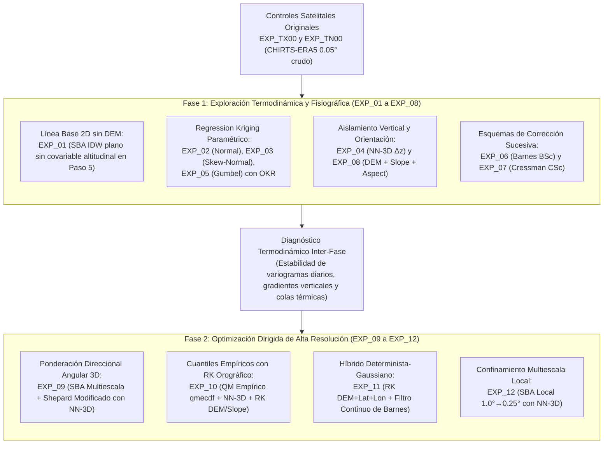

# 10. Diseño Experimental en Dos Fases y Criterios Termodinámicos para Temperatura ($T_{\max}$ y $T_{\min}$)

> **Componentes de Validación:** Suite B — Temperatura Máxima Diurna ($T_{\max}$) y Suite C — Temperatura Mínima Nocturna ($T_{\min}$)  
> **Insumos Base:** Reanálisis satelital CHIRTS-ERA5 ($0.05^\circ$) + DEM SRTM Continental Saneado ($z \ge 0\text{ msnm}$) + Termómetros NMHS  
> **Período de Reconstrucción:** 1991–2020 (30 años continuos, 10,958 días)  
> **Configuraciones Evaluadas:** 26 configuraciones térmicas (2 Controles Satelitales `EXP_TX00`/`EXP_TN00` + 16 Experimentos de Fase 1 + 8 Experimentos de Fase 2)

Este documento presenta el diseño experimental en **dos fases** para la reducción de escala orográfica (*downscaling*), corrección de sesgo y fusión espacial de temperatura máxima ($T_{\max}$) y mínima ($T_{\min}$) en **CDT v8.0**, así como los principios termodinámicos que rigen la admisibilidad física de los productos grillados resultantes.

---

## 1. Divergencia Termodinámica entre el Régimen Diurno ($T_{\max}$) y Nocturno ($T_{\min}$)

Aunque $T_{\max}$ y $T_{\min}$ comparten la misma secuencia formal de 5 pasos en CDT, representan regímenes físicos de la capa límite planetaria radicalmente distintos:

1. **Temperatura Máxima Diurna ($T_{\max}$ — Capa Límite Convectiva Bien Mezclada):**
   - Durante las horas de máxima insolación solar, la turbulencia convectiva mezcla verticalmente la atmósfera baja, estableciendo un gradiente térmico vertical estrechamente acoplado a la elevación orográfica ($\Gamma_d \approx -6.0\text{ a }-7.5\ ^\circ\text{C/km}$) modulado regionalmente por la penetración de brisas marinas y la exposición radiativa de las laderas.
2. **Temperatura Mínima Nocturna ($T_{\min}$ — Capa Límite Estable y Drenaje Catabático):**
   - Durante la noche, el enfriamiento radiativo de onda larga desacopla la superficie de la atmósfera libre. El aire frío y denso drena gravitacionalmente por las laderas (*flujo catabático*) y se acumula en valles intramontanos y depresiones cerradas (*cold-air pooling*), generando inversiones térmicas locales ($\partial T / \partial z > 0$) donde el fondo del valle puede ser más frío que las laderas circundantes (Whiteman, 2000; Daly et al., 2008).

Por esta razón, el diseño experimental evalúa de forma paralela pero diferenciada **13 configuraciones para $T_{\max}$** y **13 configuraciones para $T_{\min}$**.

---

## 2. Arquitectura Experimental en Dos Fases (26 Configuraciones Térmicas)

---

## 3. Fase 1: Exploración de Covariables Fisiográficas y Familias Estadísticas (`EXP_01` a `EXP_08`)

La **Fase 1** somete a prueba ocho hipótesis sobre el acoplamiento entre topografía, distribución estadística de temperaturas diarias y estructura de interpolación espacial:

| ID ($T_{\max}$ / $T_{\min}$) | Desescalado (Pasos 1–2) | Ajuste de Sesgo (Pasos 3–4) | Fusión Espacial (Paso 5) | Hipótesis Termodinámica Evaluada |
| :---: | :--- | :--- | :--- | :--- |
| **`EXP_TX01` / `TN01`** | Lineal plano sin DEM | `mbvar` ($\pm 5\text{ d}$) + IDW ($3.5^\circ$) | `SBA` IDW Monocapa ($1.0^\circ$, sin DEM) | **Control Planar 2D:** Evalúa el efecto de omitir la elevación orográfica en la fusión espacial. |
| **`EXP_TX02` / `TN02`** | Regresión DEM ($z \ge 0\text{ m}$) | `qmdist` (Normal) + IDW | `RK` ($\text{DEM}$) + Kriging Ordinario (`OKR`) | **Gradiente Adiabático Estándar:** Modela la caída lineal de temperatura con la altitud bajo supuesto gaussiano. |
| **`EXP_TX03` / `TN03`** | Regresión DEM + Pendiente | `qmdist` (Skew-Normal) + OKR | `RK` ($\text{DEM} + \text{Slope} + \text{Coords}$) + `OKR` | **Asimetría Estacional:** Captura colas sesgadas por intrusiones de aire polar (*Nortes*) o advección cálida. |
| **`EXP_TX04` / `TN04`** | Orográfico 3D con DEM | `mbvar` ($\pm 5\text{ d}$) + **NN-3D ($\Delta z$)** | `RK` ($\text{DEM} + \text{Slope} + \text{Aspect/Coords}$) + `OKR` | **Desacople Vertical Cima-Valle:** Restringe la transferencia de sesgo a estaciones situadas en el mismo piso altitudinal ($\Delta z$). |
| **`EXP_TX05` / `TN05`** | Regresión altimétrica DEM | `qmdist` (Gumbel) + OKR | `RK` ($\text{DEM} + \text{Coords}$) + `OKR` | **Extremos de Valor Extremo (Gumbel):** Evalúa el ajuste paramétrico de olas de calor diurnas y heladas nocturnas. |
| **`EXP_TX06` / `TN06`** | Regresión regional DEM | `mbvar` ($\pm 5\text{ d}$) + IDW | **Barnes (`BSc`)** 3 pasadas gaussianas | **Difusión Térmica Costera:** Suavizado gaussiano continuo de gradientes térmicos litorales. |
| **`EXP_TX07` / `TN07`** | Regresión altimétrica DEM | `mbmon` (mensual) + IDW | **Cressman (`CSc`)** 4 pasadas ($2.5^\circ \to 0.4^\circ$) | **Configuración Guía Oficial CDT:** Convergencia radial sucesiva para aislar microclimas locales. |
| **`EXP_TX08` / `TN08`** | Multivariado DEM+Slope+Aspect | `qmdist` (Skew-Normal) + OKR/NN-3D | `RK` Total ($\text{DEM}+\text{Slope}+\text{Aspect}+\text{Coords}$) | **Complejidad Fisiográfica Total:** Incorpora insolación diferencial por orientación de ladera y drenaje topográfico. |

---

## 4. Fase 2: Optimización Termodinámica Dirigida (`EXP_09` a `EXP_12`)

La **Fase 2** aborda cuatro requerimientos críticos identificados en la teoría de interpolación micrometeorológica en terreno complejo:

1. **Reemplazo del Kriging Diario Inestable por Interpoladores Deterministas/Gaussianos Estables (`EXP_09`, `EXP_11`, `EXP_12`):**
   - Con redes de estaciones de densidad moderada, el ajuste diario automático de semivariogramas en Kriging Ordinario (`OKR`) puede resultar numéricamente inestable cuando la tendencia orográfica ya ha absorbido la mayor parte de la varianza espacial. La Fase 2 acopla la tendencia determinista de *Regression Kriging* (`RK`) con interpoladores de residuales robustos (**Filtro Gaussiano de Barnes** en `EXP_11` e **IDW / Shepard con vecindad controlada** en `EXP_09` y `EXP_10`).
2. **Corrección Empírica No-Paramétrica de Inversiones y Extremos (`EXP_10`):**
   - Emplea **Quantile Mapping Empírico (`qmecdf`)** acoplado a vecindad tridimensional `NN-3D` ($\Delta z$) y *Regression Kriging* con elevación y pendiente (`DEM + Slope`), permitiendo corregir asimetrías térmicas locales (como pozas de aire frío nocturnas en valles altos) sin forzar una distribución paramétrica Normal o Gumbel.
3. **Descomposición Híbrida Determinista-Gaussiana (`EXP_11`):**
   - Separa explícitamente el campo térmico en un **forzamiento vertical/regional determinista** ($\text{RK}$ con $\text{DEM} + \text{Lat} + \text{Lon}$) y una **anomalía de mesoescala suave** resuelta mediante el filtro espectral gaussiano de Barnes (`BSc`).
4. **Confinamiento Multiescala con Vecindad Tridimensional (`EXP_12`):**
   - Aplica ajuste de sesgo en 3 dimensiones (`NN-3D`) seguido de fusión `SBA` con radios decrecientes ($1.0^\circ \to 0.50^\circ \to 0.25^\circ$) para aislar microclimas de valle sin perder continuidad espacial.

### Matriz de Hipótesis de la Fase 2 (`EXP_TX09`–`TX12` y `EXP_TN09`–`TN12`)

| ID ($T_{\max}$ / $T_{\min}$) | Ajuste de Sesgo (Pasos 3–4) | Tendencia Explícita (Paso 5) | Interpolador de Residuales (Paso 5) | Hipótesis Física de Optimización |
| :---: | :--- | :--- | :--- | :--- |
| **`EXP_TX09` / `TN09`** | `mbvar` ($\pm 5\text{ d}$) + **NN-3D ($\Delta z$)** | Implícita en fondo desescalado | `SBA` Multiescala ($1.0^\circ \to 0.33^\circ$) + **Shepard** | **Control Angular 3D:** Combina aislamiento vertical en el sesgo con derivadas direccionales de Shepard en los residuales. |
| **`EXP_TX10` / `TN10`** | **QM Empírico (`qmecdf`)** + **NN-3D ($\Delta z$)** | **`RK` ($\text{DEM} + \text{Slope}$)** | IDW local sobre residuales de regresión ($2.0^\circ$) | **Termodinámica de Valles y Extremos:** Captura no-linealidades de colas térmicas e inversiones nocturnas mediante ECDF y pendiente. |
| **`EXP_TX11` / `TN11`** | `mbvar` ($\pm 5\text{ d}$) + IDW ($3.5^\circ$) | **`RK` ($\text{DEM} + \text{Lat} + \text{Lon}$)** | **Barnes (`BSc`)** continuo ($2.0^\circ$, 3 pasadas) | **Síntesis Orográfica-Gaussiana:** Resuelve el gradiente adiabático vertical con el DEM y suaviza brisas y anomalías sin *ojos de buey*. |
| **`EXP_TX12` / `TN12`** | `mbvar` ($\pm 5\text{ d}$) + **NN-3D ($\Delta z$)** | Implícita en fondo desescalado | `SBA` Multiescala Local ($1.0^\circ, 0.50^\circ, 0.25^\circ$) | **Confinamiento Microclimático:** Restringe el radio final a $\sim 25\text{ km}$ protegiendo el desacople altitudinal. |

---

## 5. Criterios de Admisibilidad Termodinámica y Fisiográfica

Para que una reconstrucción grillada de $T_{\max}$ y $T_{\min}$ sea físicamente válida en estudios de cambio climático, agrometeorología e hidrología de montaña, debe cumplir dos principios termodinámicos no negociables:

### 5.1 Conservación del Gradiente Térmico Vertical ($\Gamma = -\partial T / \partial z$) y Rechazo de Modelos Planos 2D
En regiones montañosas donde la altitud varía más de $3,500\text{ m}$ en decenas de kilómetros, la red de estaciones meteorológicas presenta un fuerte **sesgo de muestreo hipso-espacial** (la mayoría de las estaciones se ubican en valles agrícolas y llanuras costeras entre $0\text{ y }1,500\text{ msnm}$, con ausencia casi total de termómetros en cumbres $>2,500\text{ msnm}$).

- Si en el Paso 5 de fusión se emplea una interpolación bidimensional plana que ignora el DEM (`EXP_TX01` y `EXP_TN01`), los residuales cálidos de las estaciones de valle se propagan horizontalmente sobre las cimas montañosas adyacentes, **destruyendo el enfriamiento adiabático con la altura** y generando islas cálidas espurias en las cumbres.
- Dado que las estaciones de validación (*holdout*) también se ubican mayoritariamente en valles y llanuras habitadas, las métricas estadísticas puntuales pueden otorgar puntajes elevados a un modelo plano 2D (*Paradoja de la Validación Cruzada en Terreno Complejo*; Daly, 2006). Por consiguiente, **toda configuración que omita el forzamiento topográfico del DEM es físicamente inadmisible**, independientemente de sus métricas en estaciones de baja altitud.

### 5.2 Suavidad Diferenciable del Campo Térmico vs. Artefactos Concéntricos
La temperatura del aire es una variable física intensiva continua regida por la ecuación de advección-difusión turbulenta. La presencia de discontinuidades concéntricas (*ojos de buey*) alrededor de estaciones térmicas —típica de interpoladores `IDW` de una sola pasada o con exponentes rígidos sobre mallas densas— introduce gradientes horizontales artificiales ($\nabla_H T$) irreales. Los esquemas híbridos que combinan **tendencia topográfica explícita (`RK` con DEM)** y **filtrado gaussiano de Barnes o ponderación direccional multicapa** garantizan tanto la fidelidad al relieve como la continuidad física de las isotermas.
