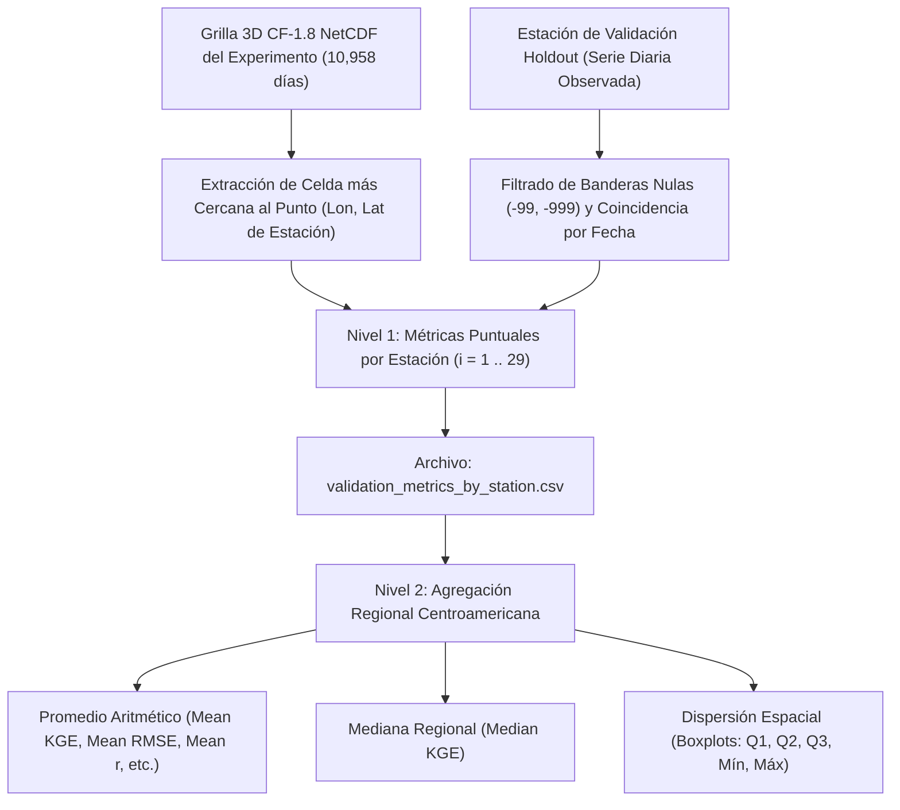

# Metodología de Evaluación Estadística, Métricas y Validación Cruzada en CDT 8.0

Este documento detalla el marco metodológico, las formulaciones matemáticas rigurosas y la interpretación física de las métricas estadísticas implementadas para la validación de los productos climáticos reconstruidos de precipitación y temperatura en América Central y República Dominicana (1991–2020).

---

## 1. Esquema de Validación Cruzada Ciega (*Holdout Validation*)

Para garantizar una evaluación científica imparcial, reproducible y evitar el sobreajuste (*overfitting* o memorización de datos), el pipeline implementa una partición estricta de las redes de estaciones meteorológicas:

* **Estaciones de Entrenamiento (*Training Stations*):** Utilizadas activamente por CDT para el cálculo de coeficientes de sesgo (*bias coefficients*), regresiones multivariadas contra el DEM y la fusión espacial (*merging*).
* **Estaciones de Validación Ciega (*Holdout Stations*):** Estaciones reservadas que **nunca intervienen** en ninguna fase del ajuste de sesgo ni de la interpolación. La grilla reconstruida se evalúa a ciegas contra estas estaciones.

### Distribución de la Red en Centroamérica (Serie Diaria 1991–2020)

| Variable Climática | Total Red de Superficie | Estaciones de Entrenamiento (Calibración/Fusión) | Estaciones Holdout (Validación Ciega) | Porcentaje de Reserva |
| :--- | :---: | :---: | :---: | :---: |
| **Precipitación Diaria (CHIRPS)** | 266 | 237 | **29** | ~11% |
| **Temperatura Máxima (CHIRTS)** | 266 | 237 | **29** | ~11% |
| **Temperatura Mínima (CHIRTS)** | 266 | 237 | **29** | ~11% |

Las 29 estaciones de validación independiente fueron seleccionadas para cubrir representativamente:
1. Vertientes marítimas contrastantes (Pacífico vs. Mar Caribe / Golfo de México).
2. Gradientes altitudinales (costas bajas a 0 msnm, valles intermontanos a 800–1,500 msnm, y tierras altas >2,000 msnm).
3. Regímenes climáticos del Corredor Seco Centroamericano (*Dry Corridor*) y bosques húmedos tropicales.

---

## 2. Niveles de Cálculo: Puntual vs. Agregación Regional

Una pregunta fundamental en la auditoría climática es la escala a la que se calculan los estadísticos:



### Nivel 1: Cálculo Puntual por Estación (`validation_metrics_by_station.csv`)
Para cada estación $i$, se toma la serie temporal de observaciones $O_{i,t}$ y la serie extraída de la grilla corregida $S_{i,t}$ para cada día $t \in [1, T]$ donde ambos registros son válidos. Todas las métricas estadísticas continuas y categóricas se evalúan individualmente para cada estación.

### Nivel 2: Agregación Regional (`validation_summary.json` y Dashboard)
El valor escalar reportado en el ranking general corresponde al **promedio aritmético regional**:

$$\overline{M} = \frac{1}{N} \sum_{i=1}^{N} M_i$$

Donde $N = 29$ estaciones. Adicionalmente, se reporta la **mediana regional** ($\text{Mediana}(M_i)$), la cual proporciona una medida de tendencia central no sesgada por microclimas extremos o estaciones atípicas.

---

## 3. Formulación Matemática de las Métricas Continuas

### 3.1. Eficiencia de Kling-Gupta (KGE, Gupta et al. 2009; Kling et al. 2012)
Es la métrica primaria de optimización en CDT y el benchmark. Integra simultáneamente la correlación temporal, el sesgo volumétrico y la dispersión relativa:

$$\text{KGE} = 1 - \sqrt{(r - 1)^2 + (\beta - 1)^2 + (\gamma - 1)^2}$$

Donde:
* **$r$ (Coeficiente de Correlación de Pearson):** Mide la sincronía y covariación en el tiempo.
  $$r = \frac{\sum_{t=1}^T (O_t - \mu_o)(S_t - \mu_s)}{\sqrt{\sum_{t=1}^T (O_t - \mu_o)^2} \sqrt{\sum_{t=1}^T (S_t - \mu_s)^2}}$$
* **$\beta$ (Razón de Sesgo Medio):** Mide el sesgo en el primer momento estadístico.
  $$\beta = \frac{\mu_s}{\mu_o}$$
* **$\gamma$ (Razón de Variabilidad / Coeficiente de Variación):** Mide la capacidad de reproducir la dispersión relativa sin confundirla con el sesgo en la media.
  $$\gamma = \frac{\text{CV}_s}{\text{CV}_o} = \frac{\sigma_s / \mu_s}{\sigma_o / \mu_o}$$

* **Interpretación:**
  * $\text{KGE} = 1.0$: Concordancia perfecta entre grilla y estaciones.
  * $\text{KGE} > 0.30$: Desempeño hábil en precipitación tropical diaria out-of-sample.
  * $\text{KGE} = 0.0$: La grilla no aporta más información que el promedio climatológico de la estación.
  * $\text{KGE} < -0.41$: El promedio histórico observado supera en habilidad predictiva a la grilla.

---

### 3.2. Raíz del Error Cuadrático Medio (RMSE)
Cuantifica la magnitud absoluta del error promedio, con una ponderación cuadrática que penaliza con severidad los errores en eventos extremos:

$$\text{RMSE} = \sqrt{\frac{1}{T} \sum_{t=1}^T (S_t - O_t)^2}$$

* **Unidades:** mm/día para lluvia; °C para temperatura.
* **Interpretación:** Deseable lo más bajo posible ($\text{RMSE} \to 0$).

---

### 3.3. Error Absoluto Medio (MAE)
Cuantifica la desviación lineal media entre la grilla y la estación, ofreciendo una lectura directa de la incertidumbre cotidiana sin sobrerreaccionar a valores extremos aislados:

$$\text{MAE} = \frac{1}{T} \sum_{t=1}^T |S_t - O_t|$$

* **Unidades:** mm/día para lluvia; °C para temperatura.

---

### 3.4. Sesgo Porcentual Relativo (PBIAS)
Mide la tendencia acumulada de la grilla a sobreestimar o subestimar el volumen hídrico o la energía térmica total:

$$\text{PBIAS} = 100 \times \frac{\sum_{t=1}^T (S_t - O_t)}{\sum_{t=1}^T O_t}$$

* **Interpretación:**
  * $\text{PBIAS} = 0.0\%$: Balance hídrico / térmico neto perfecto.
  * $\text{PBIAS} > 0$: Sobreestimación acumulada sistemática (sesgo húmedo o cálido).
  * $\text{PBIAS} < 0$: Subestimación acumulada sistemática (sesgo seco o frío).
  * Rango excelente en hidrología y climatología: $[-10\%, +10\%]$.

---

## 4. Formulación de Métricas Categóricas de Lluvia (Matriz de Contingencia)

Para la precipitación diaria, un modelo cuantitativo puede tener una correlación razonable pero fallar en predecir cuándo llueve y cuándo no. Para auditar esta capacidad, se aplica un umbral físico de lluvia cuantificable ($1.0\text{ mm/día}$) y se construye la matriz de contingencia diaria $2 \times 2$:

| Evento de Lluvia ($\ge 1.0\text{ mm}$) | Observado = Sí | Observado = No |
| :--- | :---: | :---: |
| **Simulado / Grilla = Sí** | **Aciertos ($a$, *Hits*)** | **Falsas Alarmas ($b$, *False Alarms*)** |
| **Simulado / Grilla = No** | **Omisiones ($c$, *Misses*)** | **Negativos Correctos ($d$, *Correct Negatives*)** |

### 4.1. Probabilidad de Detección (POD / *Hit Rate*)
De todos los días en que realmente llovió en la estación, ¿qué fracción detectó la grilla?

$$\text{POD} = \frac{a}{a + c}$$

* Rango: $[0, 1]$; Óptimo: $1.0$ ($100\%$).

### 4.2. Razón de Falsas Alarmas (FAR)
De todos los días en que la grilla reportó lluvia, ¿qué fracción fueron días completamente secos en el terreno?

$$\text{FAR} = \frac{b}{a + b}$$

* Rango: $[0, 1]$; Óptimo: $0.0$ ($0\%$).

### 4.3. Puntuación de Amenaza Equitativa (ETS / *Equitable Threat Score*)
Mide la habilidad de detección neta descontando explícitamente los aciertos que habrían ocurrido por puro azar:

$$\text{ETS} = \frac{a - a_{\text{azar}}}{a + b + c - a_{\text{azar}}}$$

Donde los aciertos esperados por azar son:
$$a_{\text{azar}} = \frac{(a + b)(a + c)}{a + b + c + d}$$

* Rango: $[-1/3, 1]$; Óptimo: $1.0$. Valores $>0$ indican habilidad predictiva real superior a la climatología aleatoria.

### 4.4. Puntuación de Habilidad de Heidke (HSS)
Mide la exactitud global del pronóstico categórico (lluvia vs. no-lluvia) en relación con una estimación de referencia por azar:

$$\text{HSS} = \frac{2(a \cdot d - b \cdot c)}{(a + c)(c + d) + (a + b)(b + d)}$$

* Rango: $[-\infty, 1]$; Óptimo: $1.0$. $\text{HSS} > 0.40$ representa una habilidad de discriminación sumamente alta.

---

## 5. El Diagrama de Taylor: Síntesis Geométrica Tridimensional

El Diagrama de Taylor (Taylor, 2001) es una herramienta estándar en meteorología que grafica simultáneamente tres estadísticas clave en un plano polar:

$${E'}^2 = \sigma_{\text{sim}}^2 + \sigma_{\text{obs}}^2 - 2 \sigma_{\text{sim}} \sigma_{\text{obs}} r$$

Al normalizar las variables dividiendo por la desviación estándar observada $\sigma_{\text{obs}}$:

$$\sigma^* = \frac{\sigma_{\text{sim}}}{\sigma_{\text{obs}}}, \quad E'^* = \frac{E'}{\sigma_{\text{obs}}}$$

$${E'^*}^2 = {\sigma^*}^2 + 1 - 2 \sigma^* r$$

```
           Diagrama de Taylor Normalizado
           r = 0.0          r = 0.5          r = 1.0
             |                /                /
             |               /                /
     2.0 +   +             /                /
         |    \           /                /
         |     \         /                /
     1.0 +      \       /                * (1.0, r=1) [OBSERVACIÓN]
         |       \     /               / :
         |        \   /              /   : Distancia = E'* (RMS centrado)
     0.0 +---------+----------------+----+-- Radio = sigma*
        0.0       0.5              1.0  1.5
```

1. **Coordenada Radial ($R = \sigma^*$):** Razón entre la desviación estándar simulada y la observada.
   - Si $\sigma^* = 1.0$: La grilla reproduce exactamente la amplitud de la variabilidad observada.
   - Si $\sigma^* < 1.0$: La grilla subestima la variabilidad (grilla excesivamente suavizada).
   - Si $\sigma^* > 1.0$: La grilla sobreestima la variabilidad (grilla con ruido espurio).
2. **Coordenada Angular ($\theta = \arccos(r)$):** El ángulo polar representa el coeficiente de correlación $r$:
   - $\theta = 0^\circ \implies r = 1.0$.
   - $\theta = 60^\circ \implies r = 0.5$.
   - $\theta = 90^\circ \implies r = 0.0$.
3. **Distancia al Punto de Referencia $(1.0, 0^\circ)$:** Representa directamente el **error cuadrático medio centrado ($E'^*$)**. El método óptimo es aquel cuyo punto en el diagrama cae más cerca del punto de referencia de las observaciones.

---

## 6. Interpretación Física en el Contexto Centroamericano

### 6.1. Efecto de "Doble Penalización" (*Double Penalty Effect*) en Precipitación Diaria
En el istmo centroamericano, gran parte de la precipitación proviene de sistemas convectivos de mesoescala (tormentas locales vespertinas de 3 a 10 km de diámetro) y ondas tropicales del este. 
Si una tormenta descarga $60\text{ mm}$ sobre la estación física, pero el satélite la ubicó a solo $8\text{ km}$ de distancia (en la celda contigua):
* La celda sobre la estación reporta $0\text{ mm}$ (penalización 1: omisión).
* La celda vecina reporta $60\text{ mm}$ donde no hubo estación (penalización 2: falsa alarma).

Este fenómeno penaliza fuertemente el KGE y el RMSE diario puntual. Por tanto, un $\text{KGE}$ diario de $0.35$ a $0.40$ en validación independiente representa un producto **de altísima fidelidad física**, especialmente cuando viene respaldado por una probabilidad de detección ($\text{POD}$) superior al $65\%$ y un $\text{HSS} > 0.45$.

### 6.2. El Factor Orográfico y el Filtro Lluvia-No-Lluvia ($RnoR$)
En zonas montañosas como la Cordillera Central (Costa Rica), la Sierra Madre (Guatemala) o la Sierra de Sulaco (Honduras), los satélites infrarrojos tienden a interpretar nubes orográficas frías como núcleos de precipitación continua, sobreestimando los días lluviosos. La activación del filtro $RnoR$ con umbral logit calibrado localmente permite eliminar las falsas lloviznas espurias, reduciendo drásticamente el sesgo volumétrico ($PBIAS$).

---

## 7. Referencias Bibliográficas

1. **Gupta, H. V., Kling, H., Yilmaz, K. K., & Martinez, G. F. (2009).** *Decomposition of the mean squared error and NSE performance criteria: Implications for improving hydrological modelling.* Journal of Hydrology, 377(1-2), 80-91.
2. **Kling, H., Fuchs, M., & Paulin, M. (2012).** *Runoff conditions in the upper Danube basin under an ensemble of climate change scenarios.* Journal of Hydrology, 424-425, 264-277.
3. **Taylor, K. E. (2001).** *Summarizing multiple aspects of model performance in a single diagram.* Journal of Geophysical Research: Atmospheres, 106(D7), 7183-7192.
4. **Dinku, T., et al. (2018).** *Validation of the CHIRP and CHIRPS precipitation estimates over eastern Africa.* International Journal of Climatology, 38(7), 2928-2942.
5. **Faniriantsoa, R., & Dinku, T. (2022).** *Climate Data Tools (CDT): An R package for data quality control, homogenization and merging station data with satellite and reanalysis data.* IRI Technical Report, Columbia University.
