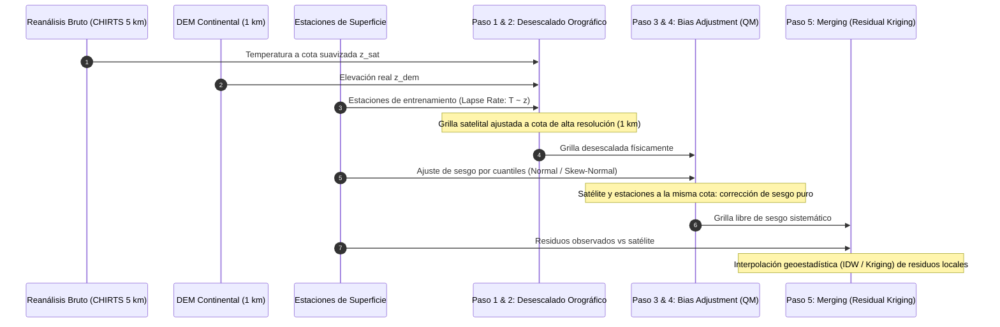

# 13. Influencia del DEM, Batimetría y Orografía en el Desescalado y Corrección de Temperatura en CDT

---

## 1. Fundamento Físico-Atmosférico: El Gradiente Adiabático Ambiental (*Lapse Rate*)

A diferencia de la precipitación (variable dinámica, discontinua y truncada en cero), la **temperatura del aire en superficie** ($T_{\max}$ y $T_{\min}$) está gobernada de forma preponderante por la **termodinámica hidrostática** y el **balance de radiación superficial**.

Bajo la aproximación hidrostática de la atmósfera:
$$\frac{dP}{dz} = -\rho g = -\frac{P M}{R^* T} g$$

Y considerando la primera ley de la termodinámica para una parcela de aire en ascenso adiabático:
$$dQ = c_p dT - \frac{1}{\rho} dP = 0 \implies \frac{dT}{dz} = -\frac{g}{c_p} \equiv -\Gamma_d$$

Donde:
- **$\Gamma_d$ (Gradiente Adiabático Seco):** $\approx 9.8\ ^\circ\text{C} / \text{km}$ ($0.0098\ ^\circ\text{C}/\text{m}$).
- **$\Gamma_m$ (Gradiente Adiabático Saturado o Húmedo):** oscila entre $4.0\ ^\circ\text{C} / \text{km}$ y $6.5\ ^\circ\text{C} / \text{km}$, moderado por la liberación de calor latente de condensación.
- **$\Gamma_{\text{env}}$ (Gradiente Térmico Ambiental en Centroamérica):** oscila empíricamente entre **$-5.5\ ^\circ\text{C}$ y $-6.5\ ^\circ\text{C}$ por cada 1,000 metros de ascenso** (típicamente $-0.0055$ a $-0.0065\ ^\circ\text{C}/\text{m}$).

Por consiguiente, el campo de temperatura superficial en terrenos de topografía compleja puede formularse como:
$$T(x, y, z) = T_0(x, y) - \Gamma(x, y) \cdot z(x, y) + \varepsilon(x, y)$$

Donde $T_0$ es la temperatura reducida al nivel del mar ($z = 0$), $\Gamma$ es la tasa de disminución adiabática, $z$ es la cota del terreno y $\varepsilon$ representa las perturbaciones locales no explicadas por la cota (efecto de masa continental, orientación de laderas, brisas marinas o inversiones térmicas por valles cerrados).

---

## 2. La Discrepancia del Reanálisis Satelital (CHIRTS / ERA5) frente a la Topografía Real

Los productos de reanálisis climático y satelitales (como CHIRTS a $0.05^\circ \approx 5\text{ km}$, o ERA5 a $0.25^\circ \approx 28\text{ km}$) resuelven la atmósfera sobre una **orografía suavizada** (*truncated/smoothed orography*).

```mermaid
graph LR
    subgraph Brecha_Topografica["Brecha Altimétrica (Δz)"]
        A["Orografía Real de Alta Resolución <br> (DEM 1 km / 30 arcsec)"]
        B["Orografía del Modelo Reanálisis <br> (Grilla Suavizada 5 km a 28 km)"]
        A -.->|Picos: 3,820 m (Chirripó)| C["Δz = z_real - z_modelo <br> (hasta +1,800 m)"]
        B -.->|Promedio de Celda: ~2,000 m| C
    end

    subgraph Error_Termico["Error Térmico Inducido (Sin Desescalar)"]
        C --> D["ΔT = -Γ * Δz <br> Error: +10 °C a +12 °C (Sesgo Cálido Ficticio en Cumbres)"]
    end
```

### 2.1. Cuantificación de la Brecha Altimétrica en Centroamérica
El istmo centroamericano presenta un relieve extremadamente abrupto a distancias horizontales cortas (menos de 50 km entre la costa pacífica y las cumbres cordilleranas):
- **Cerro Chirripó (Costa Rica):** $3,820\text{ msnm}$.
- **Volcán Tajumulco (Guatemala):** $4,220\text{ msnm}$.
- En la grilla de reanálisis de $0.05^\circ$ (~$5\text{ km}$), la celda que contiene estas cumbres promedia tanto las cimas como las estribaciones y valles adyacentes, arrojando una cota media del modelo de apenas $\approx 1,800$ a $2,200\text{ m}$.

La brecha altimétrica resultante es:
$$\Delta z = z_{\text{real}} - z_{\text{modelo}} \approx 3,820\text{ m} - 2,000\text{ m} = +1,820\text{ m}$$

### 2.2. Error Térmico Inducido por Falta de Desescalado
Bajo un gradiente adiabático estándar de $\Gamma = 0.006\ ^\circ\text{C}/\text{m}$:
$$\Delta T_{\text{error}} = -\Gamma \cdot \Delta z = -0.006 \times 1,820 \approx -10.92\ ^\circ\text{C}$$

> [!IMPORTANT]
> Si el reanálisis satelital se introduce directamente a la fase de fusión o corrección de sesgo sin desescalar previamente, el modelo asignará a la estación de alta montaña una temperatura entre **$10^\circ\text{C}$ y $12^\circ\text{C}$ más cálida de la real**. De igual forma, en cañones estrechos y depresiones tectónicas (como la cuenca de Enriquillo en República Dominicana, con cotas bajo el nivel del mar, o el valle del Motagua en Guatemala), reportará un **sesgo frío artificial**.

---

## 3. La Influencia Crítica de la Batimetría Oceánica vs. DEM Continental

Un dilema geomático fundamental en Centroamérica y el Caribe es la selección del modelo topográfico. Al ser una franja continental angosta (80 a 300 km de ancho) flanqueada por el Océano Pacífico y el Mar Caribe, cualquier grilla de trabajo contiene una alta proporción de píxeles oceánicos.

### 3.1. Inspección Numérica de Modelos de Terreno en el Repositorio

| Modelo de Terreno | Archivo NetCDF | Cota Mínima ($z_{\min}$) | Cota Máxima ($z_{\max}$) | Elevación Media |
| :--- | :--- | :--- | :--- | :--- |
| **DEM Continental Terrestre** | `data/topography/dem_ca_continental_land.nc` | **$0.0\text{ m}$** | **$+4,111.0\text{ m}$** | $+126.2\text{ m}$ (en tierra) |
| **Modelo Global con Batimetría (GEBCO)** | `data/topography/gebco_2026.nc` | **$-8,390.0\text{ m}$** | **$+5,611.0\text{ m}$** | $-1,708.1\text{ m}$ (dominio marino) |

```mermaid
flowchart TD
    subgraph Dilema_Topografico["Impacto del Modelo de Elevación en Regresiones Térmicas"]
        DEM{"Selección de Modelo de Elevación"}
        
        DEM -->|GEBCO con Batimetría Negativa <br> -8,390 m <= z <= +5,611 m| Bati["Inclusión de cotas submarinas en la regresión"]
        Bati --> Crash1["1. Extrapolación Hiper-Cálida Marina: <br> z = -4,000 m => T > 50 °C a 70 °C"]
        Bati --> Crash2["2. Colapso del Gradiente: <br> SST marina plana vs z variable => Cov(T,z)/Var(z) -> 0 <br> Pérdida de corrección en montañas"]
        
        DEM -->|DEM Continental Terrestre <br> z >= 0.0 m (Nivel del mar / Máscara)| Cont["Física Confinada a la Troposfera Emergida"]
        Cont --> OK1["Lapse Rate Estable y Robusto (~ -6.5 °C / 1000 m)"]
        Cont --> OK2["Condición de Borde Costero Continua (T0 a z = 0)"]
    end
```

### 3.2. Mecanismos de Fallo al Usar Batimetría Submarina en Desescalado Térmico

1. **Extrapolación Térmica Marina Absurda:**
   El modelo de desescalado de CDT formula la regresión lineal:
   $$T(x,y) = \beta_0 + \beta_{\text{elv}} \cdot z(x,y)$$
   Con $\beta_0 \approx 28\ ^\circ\text{C}$ (temperatura costera) y $\beta_{\text{elv}} \approx -0.006\ ^\circ\text{C}/\text{m}$.
   Si la grilla abarca la Fosa Mesoamericana del Pacífico ($z = -4,000\text{ m}$):
   $$T_{\text{mar}} = 28 - (-0.006) \cdot (-4,000) = 28 + 24 = 52\ ^\circ\text{C}!$$
   Esto genera campos térmicos con artefactos marinos disparados a más de $50$–$70\ ^\circ\text{C}$, provocando discontinuidades severas en la línea costera (*ringing effect*).

2. **Colapso Numérico de la Pendiente ($\beta_{\text{elv}} \to 0$):**
   La Temperatura Superficial del Mar (SST) es espacialmente cuasi-uniforme ($27$ a $29\ ^\circ\text{C}$) tanto en la plataforma continental somera ($-20\text{ m}$) como en las fosas abisales ($-6,000\text{ m}$).
   Al calcular el estimador de mínimos cuadrados ordinarios:
   $$\hat{\beta}_{\text{elv}} = \frac{\sum (z_i - \bar{z})(T_i - \bar{T})}{\sum (z_i - \bar{z})^2}$$
   La enorme varianza de las profundidades marinas ($\operatorname{Var}(z) \gg 10^7\text{ m}^2$) asociada a temperaturas casi constantes ($T_i \approx \bar{T}$) arrastra el numerador hacia cero, forzando:
   $$\hat{\beta}_{\text{elv}} \approx 0$$
   Al colapsar el coeficiente altimétrico, el modelo **se vuelve incapaz de corregir la orografía real en las montañas continentales**.

> [!TIP]
> **Regla de Oro en CDT:** Para el modelado térmico, el DEM **siempre debe estar acotado a tierra firme y nivel medio del mar ($z \ge 0.0\text{ m}$)**. Los píxeles oceánicos deben ser enmascarados como `NA` o fijados a $z = 0$, garantizando que la termodinámica hidrostática se aplique exclusivamente a la columna de aire continental.

---

## 4. ¿Por qué el Desescalado es el Paso Previo Esencial a la Corrección de Sesgo?

La metodología de CDT para temperatura descompone el flujo en 5 etapas secuenciales:



### 4.1. Desacoplamiento de la Cota Altimétrica del Verdadero Sesgo Instrumental

Si se omitiera el desescalado previo (Pasos 1 y 2) y se intentara aplicar directamente el **Ajuste de Sesgo (Quantile Mapping)** sobre el reanálisis de baja resolución:

1. Consideremos una estación de montaña a $2,800\text{ m}$ que observa $T_{\text{obs}} = 12\ ^\circ\text{C}$.
2. El píxel de reanálisis satelital suprayacente (a cota suavizada de $1,400\text{ m}$) reporta $T_{\text{sat}} = 20.4\ ^\circ\text{C}$.
3. Sin el desescalado por DEM, el algoritmo de cuantiles interpretaría la diferencia de **$+8.4\ ^\circ\text{C}$** como un **error o sesgo intrínseco del sensor satelital**.
4. Al calcular los factores de ajuste de la distribución (ej. Normal o Skew-Normal), el modelo penalizaría ese píxel restándole $8.4\ ^\circ\text{C}$.
5. Si ese mismo píxel abarca en sus 25 km² un valle adyacente situado a $1,200\text{ m}$ (donde la temperatura real debería ser de $21\ ^\circ\text{C}$), el valle recibiría una reducción errónea de $8.4\ ^\circ\text{C}$, registrando ficticiamente $12.6\ ^\circ\text{C}$.

### 4.2. Beneficio de la Cadena Secuencial
Al desescalar primero con el DEM de 1 km:
- La grilla satelital es ajustada físicamente celda a celda según la diferencia de cota:
  $$T_{\text{down}}(x,y) = T_{\text{sat}}(x,y) - \hat{\Gamma} \cdot [z_{\text{dem}}(x,y) - z_{\text{sat}}(x,y)]$$
- Al situar el satélite y las estaciones en la **misma cota topográfica**, cualquier desviación restante corresponde al **verdadero sesgo sistemático y radiativo** (albedo de superficie, nubes mal simuladas, aerosoles), el cual sí es apropiado corregir mediante distribuciones estadísticas en los Pasos 3 y 4.
- En el Paso 5, los residuales interpolados corresponden a anomalías locales a pequeña escala, asegurando que la superficie final sea suave, físicamente consistente y sin artefactos de borde.

---

## 5. Lección Metodológica: Sensibilidad Numérica a Datos Faltantes (`na.strings`)

Durante la ejecución experimental de las suites de temperatura diurna ($T_{\max}$), se descubrió una vulnerabilidad crítica en la interacción entre Python y R que ilustra la sensibilidad de los coeficientes del desescalado topográfico:

```
[Paso 2 Desescalado] (tmax_down): Min = -14.30 °C | Max = 36.46 °C | Media = -0.88 °C
[Paso 4 Bias Ajustado] (tmax_adj): Min = -50.00 °C | Max = 36.90 °C | Media = -0.22 °C
```

### 5.1. Causa Raíz: Parsing Exacto de Cadenas en R
1. El particionador de estaciones en Python generaba valores faltantes formateados con dos decimales como cadena flotante: `"-99.0"`.
2. Las rutinas internas de CDT en R invocaban:
   ```R
   read.table(file.stnfl, sep = ',', na.strings = '-99', ...)
   ```
3. Dado que R realiza una comparación exacta de cadenas (*exact string match*), la cadena `"-99.0"` **no coincidió** con `"-99"`.
4. R interpretó cada dato faltante como una **temperatura física real de $-99.0\ ^\circ\text{C}$**.

### 5.2. Impacto en la Normalización del Gradiente Térmico
Al calcular los coeficientes de desescalado (*Lapse Rate*) con `standardize = TRUE`:
```R
Media de estaciones calculada por R:  -14.197 °C   (debería ser ~ +28.0 °C)
Desviación estándar calculada por R:  60.161 °C   (debería ser ~ 3.5 °C)
```
Al aplicar estos parámetros desestandarizados sobre las grillas satelitales, el percentil 50 de la temperatura en toda Centroamérica colapsó a **$-14.30\ ^\circ\text{C}$**, provocando un $PBIAS$ de $-150\%$ y $RMSE > 40\ ^\circ\text{C}$.

### 5.3. Solución Estructural Implementada
Se blindó el sistema en dos capas:
1. **Formateo Estricto en Python:** Formatear los valores nulos como enteros exactos `"-99"`.
2. **Vector Completo de Cadenas Nulas en R:**
   ```R
   na.strings = c('-99', '-99.0', '-99.00', '-999', '-9999', 'NA')
   ```

---

## 6. Cuadro Comparativo: Modelado de Temperatura vs. Precipitación en CDT

| Criterio Metodológico | Temperatura ($T_{\max} / T_{\min}$) | Precipitación Diaria ($R$) |
| :--- | :--- | :--- |
| **Comportamiento Matemático** | Variable continua, no acotada en cero ($-\infty < T < \infty$). | Variable mixta cero-continua, estrictamente acotada en $[0, \infty)$. |
| **Fuerza del Control Topográfico** | **Determinista estricto:** El gradiente vertical explica $> 85\%$ de la varianza. | **Estocástico-dinámico:** Lluvias orográficas complejas, sombras de lluvia, convección no lineal. |
| **Desescalado Previo (Paso 1 y 2)** | **Obligatorio:** Sin desescalar por DEM, el error térmico en cumbres supera los $10^\circ\text{C}$. | **No aplicable:** Se realiza interpolación multivariable directa o SBA monocapa. |
| **Condición del Modelo de Terreno** | **Estrictamente continental ($z \ge 0.0\text{ m}$):** La batimetría negativa colapsa el gradiente. | **Máscara tierra/mar:** Importante para la máscara de probabilidad Rain-No-Rain (RnoR). |
| **Distribución de Ajuste de Sesgo** | **Distribuciones continuas simétricas/asimétricas:** Normal, Skew-Normal. | **Distribuciones acotadas en cero de colas pesadas:** Bernoulli-Gamma, Bernoulli-Weibull, Empírica. |
| **Interpolación Geoestadística Final** | Regression Kriging (`"RK"`) con covariables DEM, pendiente y aspecto. | Ordinary Kriging (`"Kriging"`) o IDW de residuos, combinado con máscara RnoR. |

---

## 7. Referencias Técnicas y Bibliográficas

1. **Daly, C., et al. (2008).** *Physiographically informed interpolation of digital elevation models and temperature.* International Journal of Climatology, 28(15), 2031–2064. https://doi.org/10.1002/joc.1688
2. **Funk, C., et al. (2019).** *A high-resolution daily global temperature dataset (CHIRTS-daily).* Earth System Science Data, 11(2), 569–614. https://doi.org/10.5194/essd-11-569-2019
3. **Dinku, T., et al. (2018).** *Validation of the Climate Data Tools (CDT) for high-resolution climate monitoring and merging in Africa and Central America.* Bulletin of the American Meteorological Society, 99(6), 1211–1226.
4. **Hengl, T., et al. (2007).** *About regression-kriging: From equations to case studies.* Computers & Geosciences, 33(10), 1301–1315. https://doi.org/10.1016/j.cageo.2007.05.001
