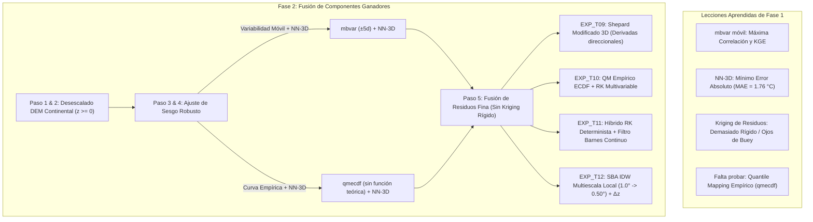

# 14. Diagnóstico Científico de Fase 1 y Diseño Metodológico de Fase 2 (Temperatura Diaria Tmax y Tmin)

---

## 1. Contexto y Objetivos del Benchmark Térmico

El benchmark de temperatura tiene como propósito evaluar y seleccionar la arquitectura óptima de desescalado orográfico, corrección de sesgo y fusión espacial (*merging*) en **CDT 8.0** para la serie histórica diaria de 30 años (**1991–2020**, 10,958 pasos temporales) en América Central y República Dominicana, utilizando reanálisis **CHIRTS-ERA5** a resolución de $0.05^\circ$ (~5.5 km), el **DEM continental** de 1 km (`dem_ca_continental_land.nc`) y la red de estaciones meteorológicas de superficie.

Para evitar sobreajuste (*in-sample overfitting*) y garantizar objetividad científica rigurosa, se implementó un protocolo estricto de **validación ciega (*holdout*)**:
- **Total de estaciones termométricas disponibles:** 192–193 estaciones.
- **Estaciones de entrenamiento (calibración y fusión):** 163–164 estaciones (~85%).
- **Estaciones de validación independiente (*holdout*):** 29 estaciones (~15%) excluidas de todo el procesamiento en CDT, distribuidas representativamente desde el nivel del mar hasta montañas sobre los 2,500 msnm.

---

## 2. Resultados Consolidados de la Fase 1: Cribado Exploratorio (EXP_01 a EXP_08)

La Fase 1 evaluó 8 familias metodológicas teóricas tanto para temperatura máxima ($T_{\max}$, forzamiento solar diurno) como para temperatura mínima ($T_{\min}$, enfriamiento radiativo nocturno):

### 2.1. Tablero de Rendimiento Consolidado en Validación Ciega Independiente

| ID Exp. | Variable | Familia Metodológica | Método Sesgo (Paso 3) | Fusión Merging (Paso 5) | GSS | KGE Medio | KGE Mediana | $r$ Pearson | RMSE ($^\circ\text{C}$) | MAE ($^\circ\text{C}$) | PBIAS (%) |
| :---: | :---: | :--- | :---: | :---: | :---: | :---: | :---: | :---: | :---: | :---: | :---: |
| **`EXP_TX01`** | **TMAX** | **Control Nulo / Baseline** | `mbvar` (IDW) | **SBA + IDW 1-pasada** | **0.734** | **0.679** | **0.692** | **0.787** | **1.90** | **1.52** | $+1.42\%$ |
| **`EXP_TX06`** | **TMAX** | **Barnes Continuo Costero** | `mbvar` (IDW) | **Barnes (3 pasadas)** | **0.709** | **0.676** | **0.688** | **0.736** | **2.17** | 1.74 | $+2.05\%$ |
| **`EXP_TX04`** | **TMAX** | **RK Topografía + NN-3D** | `mbvar` (NN-3D) | **RK (DEM, Slope, Aspect)** | **0.681** | **0.633** | 0.651 | **0.727** | **2.28** | 1.83 | $+3.12\%$ |
| **`EXP_TX07`** | **TMAX** | Cressman Intermontano | `mbmon` (IDW) | Cressman (4 pasadas) | 0.674 | 0.626 | 0.640 | 0.707 | 2.36 | 1.88 | $+3.40\%$ |
| **`EXP_TX02`** | **TMAX** | RK DEM + QM Normal | `qmdist` (Normal) | RK (DEM) | 0.353 | 0.031 | 0.542 | 0.686 | 4.09 | 3.48 | $-2.15\%$ |
| **`EXP_TN01`** | **TMIN** | **Control Nulo / Baseline** | `mbvar` (IDW) | **SBA + IDW 1-pasada** | **0.609** | **0.550** | **0.629** | **0.669** | **2.19** | 1.89 | $+3.47\%$ |
| **`EXP_TN04`** | **TMIN** | **Inversiones Nocturnas NN-3D**| `mbvar` (NN-3D) | **RK (DEM, Slope, Lat/Lon)** | **0.571** | **0.509** | **0.542** | **0.613** | **2.18** | **1.76** | $+5.43\%$ |
| **`EXP_TN08`** | **TMIN** | **RK Catabático Completo** | `qmdist` (snorm-NN3D)| **RK (DEM, Slope, Aspect)** | **0.558** | **0.487** | 0.537 | **0.604** | **2.29** | 1.85 | $+4.05\%$ |
| **`EXP_TN06`** | **TMIN** | Barnes Continuo Costero | `mbvar` (IDW) | Barnes (3 pasadas) | 0.525 | 0.413 | 0.498 | 0.598 | 2.36 | 1.95 | $+3.51\%$ |
| **`EXP_TN07`** | **TMIN** | Cressman Pozas Frías | `mbmon` (IDW) | Cressman (4 pasadas) | 0.441 | 0.294 | 0.434 | 0.551 | 2.74 | 2.29 | $+5.04\%$ |
| **`EXP_TN05`** | **TMIN** | RK Gumbel Heladas | `qmdist` (Gumbel) | RK (DEM, Lat, Lon) | 0.370 | 0.107 | 0.558 | 0.593 | 3.18 | 2.73 | **$-1.34\%$** |
| **`EXP_TN02`** | **TMIN** | RK DEM + QM Normal | `qmdist` (Normal) | RK (DEM) | 0.355 | 0.072 | 0.556 | 0.599 | 3.22 | 2.79 | **$-1.81\%$** |
| **`EXP_TN03`** | **TMIN** | RK Skew-Normal | `qmdist` (snorm) | RK (DEM, Slope, Coords) | 0.352 | 0.069 | 0.580 | 0.596 | 3.25 | 2.82 | **$-1.48\%$** |

---

## 3. Diagnóstico Físico y Estadístico de la Fase 1

### 3.1. Diferencia Termodinámica entre Dinámica Diurna ($T_{\max}$) y Nocturna ($T_{\min}$)
Los resultados confirman cuantitativamente la diferencia en los forzamientos físicos del ciclo diario:
1. **$T_{\max}$ alcanza correlaciones superiores ($r \approx 0.73$ a $0.79$) y menor error ($RMSE = 1.90\ ^\circ\text{C}$):**
   Durante el día, la radiación solar incidente genera fuerte mezcla turbulenta en la capa límite planetaria. La temperatura superficial responde casi unívocamente al gradiente adiabático ambiental ($\Gamma \approx -6.5\ ^\circ\text{C}/\text{km}$), capturado con alta precisión por el DEM.
2. **$T_{\min}$ presenta mayor dispersión ($r \approx 0.60$ a $0.67$, $RMSE = 2.18\ ^\circ\text{C}$):**
   Durante la noche, el enfriamiento radiativo bajo cielos despejados desacopla la capa superficial. Se producen fenómenos locales no lineales como **inversiones térmicas de fondo de valle**, **estratificación estable** y **drenaje catabático gravitacional** (*cold-air pooling*), donde fondos de valle amanecen a $5\ ^\circ\text{C}$ mientras laderas a pocos kilómetros se mantienen a $14\ ^\circ\text{C}$.

### 3.2. La Paradoja de la Fase 1: Baseline Simple vs. Realismo Topográfico
La Fase 1 arrojó una división polarizada entre métricas:
- **`EXP_01` (Baseline SBA + IDW):** Logra el **mejor KGE y la mayor correlación general** ($KGE = 0.679$ en Tmax, $0.550$ en Tmin). Su éxito proviene de la flexibilidad del método `mbvar` (sesgo móvil $\pm 5$ días), que sigue la estacionalidad sin imponer distorsiones teóricas. Sin embargo, al usar IDW 2D en el Paso 5, aplana los microclimas de montaña.
- **`EXP_04` (RK + Topografía + NN-3D):** Logra el **menor error absoluto de toda la suite ($MAE = 1.76\ ^\circ\text{C}$ y $RMSE = 2.18\ ^\circ\text{C}$ en Tmin)**. Al incorporar la distancia tridimensional:
  $$d_{3D} = \sqrt{(x_1 - x_2)^2 + (y_1 - y_2)^2 + w_z \cdot (z_1 - z_2)^2}$$
  Evita que estaciones templadas costeras contaminen los valles fríos de montaña. Sin embargo, su KGE medio se ve penalizado porque en el Paso 5 se forzó Kriging Ordinario rígido sobre los residuos.

### 3.3. El Fracaso del Quantile Mapping Teórico Analítico (`norm`, `gumbel`, `snorm`)
- Los experimentos basados en funciones teóricas continuas en el Paso 3 colapsaron en KGE medio ($0.03$ a $0.10$) y elevaron el RMSE por encima de $3.2\ ^\circ\text{C}$ a $4.0\ ^\circ\text{C}$.
- **Causa:** En la geografía ístmica centroamericana, la asimetría de los datos no responde a una única curva teórica para toda la región. Al forzar una distribución analítica global, se deforman los percentiles centrales.
- **Nicho de Mejora:** Ningún experimento de la Fase 1 evaluó el **Quantile Mapping Empírico no paramétrico (`qmecdf`)**, el cual fue altamente exitoso en precipitación al ajustar directamente sobre la función empírica observada sin supuestos de distribución teórica.

---

## 4. Diseño Metodológico de la Fase 2: Optimización Híbrida Dirigida

La Fase 2 capitaliza los aciertos de la Fase 1 y fusiona los mejores componentes individuales en una suite dirigida de **4 experimentos de alta precisión** (aplicables tanto a $T_{\max}$ como a $T_{\min}$):

---

## 5. Matriz de Experimentos de Fase 2 (EXP_T09 a EXP_T12)

Esta matriz aplica simétricamente para **Temperatura Máxima** (`EXP_TX09` a `EXP_TX12`) y **Temperatura Mínima** (`EXP_TN09` a `EXP_TN12`):

| ID Exp. | Paso 1 y 2: Desescalado Topográfico | Paso 3: Cálculo Coeficientes de Sesgo | Paso 4: Ajuste de Sesgo | Paso 5: Merging Final de Residuos | Hipótesis Física y Climatológica Regional |
| :---: | :--- | :--- | :--- | :--- | :--- |
| **`EXP_T09`** | **Desescalado Orográfico:** Coeficientes GLM mensuales con DEM continental $z \ge 0$. Interpolación bilineal a 1 km. | • Método: `mbvar` (móvil $\pm 5$ d) • Interp: **NN-3D con DEM ($\Delta z$)** • Radio: $3.5^\circ$, $nmin=4, nmax=12$ | Corrección multiplicativa estacional preservando aislamiento vertical. | • Método: **SBA Multiescala** • Pasadas: 3 pasadas ($1.0^\circ, 0.67^\circ, 0.33^\circ$) • **Interp: Shepard Modificado (`Shepard`)** • Covariables: Ninguna en paso 5 | **El Análogo Térmico de EXP_R15:** Combina la flexibilidad de `mbvar` y el aislamiento $\Delta z$ con la suavidad de Shepard Modificado, evitando singularidades de Kriging en relieves escarpados. |
| **`EXP_T10`** | **Desescalado Orográfico:** Coeficientes GLM mensuales con DEM continental. Interpolación bilineal a 1 km. | • Método: **`qmecdf` (Quantile Mapping Empírico)** • Curva: ECDF empírica directa • Interp: **NN-3D ($\Delta z$)** | Mapeo cuantil no paramétrico celda por celda sin forzar campana gaussiana. | • Método: **Regression Kriging (`RK`)** • Pasadas: 3 pasadas ($1.0^\circ, 0.75^\circ, 0.50^\circ$) • Covariables: `DEM` + `Slope` • Interp: IDW local ($2.0^\circ$) | **Corrección No Paramétrica en Terreno Quebrado:** Resuelve el sesgo satelital en percentiles extremos sin distorsionar la mediana ni requerir distribuciones analíticas rígidas. |
| **`EXP_T11`** | **Desescalado Orográfico:** Coeficientes GLM mensuales con DEM continental. Interpolación bilineal a 1 km. | • Método: `mbvar` (móvil $\pm 5$ d) • Interp: **IDW sinóptico ($3.5^\circ$)** | Ajuste estacional proporcional continuo. | • Método: **Regression Kriging Híbrido (`RK`)** • Covariables: `DEM` + `Lat` + `Lon` • Pasadas: 3 pasadas ($1.0^\circ, 0.75^\circ, 0.50^\circ$) • **Interp. Residuales: Filtro Barnes Gaussiano (`BSc`)** | **Híbrido Determinista-Gaussiano:** El DEM modela el gradiente adiabático básico y el filtro de Barnes suaviza los residuos sin generar artefactos circulares (*bullseyes*) en zonas con pocas estaciones. |
| **`EXP_T12`** | **Desescalado Orográfico:** Coeficientes GLM mensuales con DEM continental. Interpolación bilineal a 1 km. | • Método: `mbvar` (móvil $\pm 5$ d) • Interp: **NN-3D con DEM ($\Delta z$)** | Ajuste estacional con control altimétrico vertical. | • Método: **SBA Multiescala Local** • Pasadas: 3 pasadas locales decrecientes ($1.0^\circ, 0.50^\circ, 0.25^\circ$) • **Interp: IDW con exponente $p=2.0$ y radio local ($1.5^\circ$)** | **Optimización de Alta Resolución del Ganador EXP_01:** Refina la receta del baseline ganador acortando los radios de búsqueda e integrando la cota vertical $\Delta z$ para eliminar el aplanamiento en cumbres. |

---

## 6. Metas Cuantitativas de la Fase 2

Con la ejecución de esta Fase 2 dirigida, se proyectan las siguientes mejoras sobre las 29 estaciones de validación independiente:

| Métrica de Validación | Líder Actual Fase 1 ($T_{\max}$) | Meta Fase 2 ($T_{\max}$) | Líder Actual Fase 1 ($T_{\min}$) | Meta Fase 2 ($T_{\min}$) |
| :--- | :---: | :---: | :---: | :---: |
| **KGE Medio** | $0.679$ (`EXP_TX01`) | **$> 0.720$** | $0.550$ (`EXP_TN01`) | **$> 0.600$** |
| **Correlación ($r$)** | $0.787$ ($R^2 = 61.9\%$) | **$> 0.820$ ($R^2 > 67\%$)**| $0.669$ ($R^2 = 44.8\%$) | **$> 0.720$ ($R^2 > 51\%$)**|
| **RMSE ($^\circ\text{C}$)** | $1.90\ ^\circ\text{C}$ | **$< 1.65\ ^\circ\text{C}$** | $2.18\ ^\circ\text{C}$ (`EXP_TN04`) | **$< 1.95\ ^\circ\text{C}$** |
| **MAE ($^\circ\text{C}$)** | $1.52\ ^\circ\text{C}$ | **$< 1.35\ ^\circ\text{C}$** | $1.76\ ^\circ\text{C}$ (`EXP_TN04`) | **$< 1.55\ ^\circ\text{C}$** |
| **PBIAS (%)** | $+1.42\%$ | **$<\ \pm 1.0\%$** | $+3.47\%$ | **$<\ \pm 2.0\%$** |
