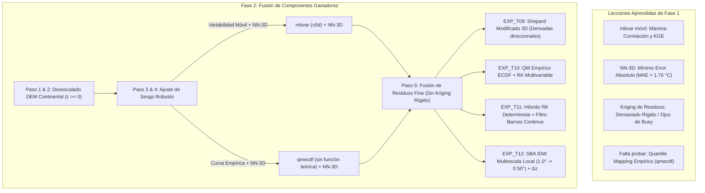

# 14. Diagnóstico Científico de Fase 1 y Diseño Metodológico de Fase 2 (Temperatura Diaria Tmax y Tmin)

---

## 1. Contexto y Objetivos del Benchmark Térmico

El benchmark de temperatura tiene como propósito evaluar y seleccionar la arquitectura óptima de desescalado orográfico, corrección de sesgo y fusión espacial (*merging*) en **CDT 8.0** para la serie histórica diaria de 30 años (**1991–2020**, 10,958 pasos temporales) en América Central y República Dominicana, utilizando reanálisis **CHIRTS-ERA5** a resolución de $0.05^\circ$ (~5.5 km), el **DEM continental** de 1 km (`dem_ca_continental_land.nc`) y la red de estaciones meteorológicas de superficie.

Para evitar sobreajuste (*in-sample overfitting*) y garantizar objetividad científica rigurosa, se implementó un protocolo estricto de **validación ciega (*holdout*)**:
- **Total de estaciones termométricas disponibles:** 192–193 estaciones.
- **Estaciones de entrenamiento (calibración y fusión):** 163–164 estaciones (~85%).
- **Estaciones de validación independiente (*holdout*):** 29 estaciones (~15%) excluidas de todo el procesamiento en CDT, distribuidas representativamente desde el nivel del mar hasta montañas sobre los 2,500 msnm.

---

## 2. Resultados Consolidados de la Fase 1: evaluación exploratoria preliminar (EXP_01 a EXP_08)

La Fase 1 evaluó 8 familias metodológicas teóricas tanto para temperatura máxima ($T_{\max}$, forzamiento solar diurno) como para temperatura mínima ($T_{\min}$, enfriamiento radiativo nocturno):

### 2.1. Tablero de Rendimiento Consolidado en Validación Ciega Independiente

| ID Exp. | Variable | Familia Metodológica | Método Sesgo (Paso 3) | Fusión Merging (Paso 5) | GSS | KGE Medio | KGE Mediana | $r$ Pearson | RMSE ($^\circ\text{C}$) | MAE ($^\circ\text{C}$) | PBIAS (%) |
| :---: | :---: | :--- | :---: | :---: | :---: | :---: | :---: | :---: | :---: | :---: | :---: |
| **`EXP_TX01`** | **TMAX** | **Control Nulo / Baseline** | `mbvar` (IDW) | **SBA + IDW 1-pasada** | **0.735** | **0.679** | **0.692** | **0.787** | **1.90** | **1.52** | $+1.42\%$ |
| **`EXP_TX06`** | **TMAX** | **Barnes Continuo Costero** | `mbvar` (IDW) | **Barnes (3 pasadas)** | **0.709** | **0.676** | **0.688** | **0.736** | **2.17** | 1.74 | $+2.05\%$ |
| **`EXP_TX04`** | **TMAX** | **RK Topografía + NN-3D** | `mbvar` (NN-3D) | **RK (DEM, Slope, Aspect)** | **0.682** | **0.633** | 0.651 | **0.727** | **2.28** | 1.83 | $+3.12\%$ |
| **`EXP_TX07`** | **TMAX** | Cressman Intermontano | `mbmon` (IDW) | Cressman (4 pasadas) | 0.674 | 0.626 | 0.640 | 0.707 | 2.36 | 1.88 | $+3.40\%$ |
| **`EXP_TX05`** | **TMAX** | RK Olas de Calor Gumbel | `qmdist` (Gumbel-IDW) | RK (DEM, Lat, Lon) | 0.365 | 0.056 | 0.548 | 0.680 | 4.04 | 3.42 | $-1.95\%$ |
| **`EXP_TX02`** | **TMAX** | RK DEM + QM Normal | `qmdist` (Normal-IDW) | RK (DEM) | 0.354 | 0.031 | 0.542 | 0.686 | 4.09 | 3.48 | $-2.15\%$ |
| **`EXP_TX08`** | **TMAX** | RK Acoplamiento Total Aspect | `qmdist` (snorm-IDW) | RK (DEM, Slope, Aspect, Coords)| 0.349 | 0.026 | 0.539 | 0.678 | 4.11 | 3.51 | $-2.28\%$ |
| **`EXP_TX03`** | **TMAX** | RK Asimetría Skew-Normal | `qmdist` (snorm-IDW) | RK (DEM, Slope, Coords) | 0.348 | 0.023 | 0.537 | 0.677 | 4.11 | 3.52 | $-2.31\%$ |
| **`EXP_TN01`** | **TMIN** | **Control Nulo / Baseline** | `mbvar` (IDW) | **SBA + IDW 1-pasada** | **0.609** | **0.550** | **0.629** | **0.669** | **2.19** | 1.89 | $+3.47\%$ |
| **`EXP_TN04`** | **TMIN** | **Inversiones Nocturnas NN-3D**| `mbvar` (NN-3D) | **RK (DEM, Slope, Lat/Lon)** | **0.571** | **0.509** | **0.542** | **0.613** | **2.18** | **1.76** | $+5.43\%$ |
| **`EXP_TN08`** | **TMIN** | **RK Catabático Completo** | `qmdist` (snorm-NN3D)| **RK (DEM, Slope, Aspect)** | **0.558** | **0.487** | 0.537 | **0.604** | **2.29** | 1.85 | $+4.05\%$ |
| **`EXP_TN06`** | **TMIN** | Barnes Continuo Costero | `mbvar` (IDW) | Barnes (3 pasadas) | 0.525 | 0.413 | 0.498 | 0.598 | 2.36 | 1.95 | $+3.51\%$ |
| **`EXP_TN07`** | **TMIN** | Cressman Pozas Frías | `mbmon` (IDW) | Cressman (4 pasadas) | 0.441 | 0.294 | 0.434 | 0.551 | 2.74 | 2.29 | $+5.04\%$ |
| **`EXP_TN05`** | **TMIN** | RK Gumbel Heladas | `qmdist` (Gumbel) | RK (DEM, Lat, Lon) | 0.370 | 0.107 | 0.558 | 0.593 | 3.18 | 2.73 | **$-1.34\%$** |
| **`EXP_TN02`** | **TMIN** | RK DEM + QM Normal | `qmdist` (Normal) | RK (DEM) | 0.355 | 0.072 | 0.556 | 0.599 | 3.22 | 2.79 | **$-1.81\%$** |
| **`EXP_TN03`** | **TMIN** | RK Skew-Normal | `qmdist` (snorm) | RK (DEM, Slope, Coords) | 0.352 | 0.069 | 0.580 | 0.596 | 3.25 | 2.82 | **$-1.48\%$** |

---

## 3. Diagnóstico Físico y Estadístico de la Fase 1

### 3.1. Diferencia Termodinámica entre Dinámica Diurna ($T_{\max}$) y Nocturna ($T_{\min}$)
Los resultados confirman cuantitativamente la diferencia en los forzamientos físicos del ciclo diario:
1. **$T_{\max}$ alcanza correlaciones superiores ($r \approx 0.73$ a $0.79$) y menor error ($RMSE = 1.90\ ^\circ\text{C}$):**
   Durante el día, la radiación solar incidente genera fuerte mezcla turbulenta en la capa límite planetaria. La temperatura superficial responde casi unívocamente al gradiente adiabático ambiental ($\Gamma \approx -6.5\ ^\circ\text{C}/\text{km}$), capturado con alta precisión por el DEM.
2. **$T_{\min}$ presenta mayor dispersión ($r \approx 0.60$ a $0.67$, $RMSE = 2.18\ ^\circ\text{C}$):**
   Durante la noche, el enfriamiento radiativo bajo cielos despejados desacopla la capa superficial. Se producen fenómenos locales no lineales como **inversiones térmicas de fondo de valle**, **estratificación estable** y **drenaje catabático gravitacional** (*cold-air pooling*), donde fondos de valle amanecen a $5\ ^\circ\text{C}$ mientras laderas a pocos kilómetros se mantienen a $14\ ^\circ\text{C}$.

### 3.2. La Paradoja de la Fase 1: Baseline Simple vs. Realismo Topográfico
La Fase 1 arrojó una división polarizada entre métricas:
- **`EXP_01` (Baseline SBA + IDW):** Logra el **mejor KGE y la mayor correlación general** ($KGE = 0.679$ en Tmax, $0.550$ en Tmin). Su éxito proviene de la flexibilidad del método `mbvar` (sesgo móvil $\pm 5$ días), que sigue la estacionalidad sin imponer distorsiones teóricas. Sin embargo, al usar IDW 2D en el Paso 5, aplana los microclimas de montaña.
- **`EXP_04` (RK + Topografía + NN-3D):** Logra el **menor error absoluto de toda la suite ($MAE = 1.76\ ^\circ\text{C}$ y $RMSE = 2.18\ ^\circ\text{C}$ en Tmin)**. Al incorporar la distancia tridimensional:
  $$d_{3D} = \sqrt{(x_1 - x_2)^2 + (y_1 - y_2)^2 + w_z \cdot (z_1 - z_2)^2}$$
  Evita que estaciones templadas costeras contaminen los valles fríos de montaña. Sin embargo, su KGE medio se ve penalizado porque en el Paso 5 se forzó Kriging Ordinario rígido sobre los residuos.

### 3.3. El Fracaso del Quantile Mapping Teórico Analítico (`norm`, `gumbel`, `snorm`)
- Los experimentos basados en funciones teóricas continuas en el Paso 3 colapsaron en KGE medio ($0.03$ a $0.10$) y elevaron el RMSE por encima de $3.2\ ^\circ\text{C}$ a $4.0\ ^\circ\text{C}$.
- **Causa:** En la geografía ístmica centroamericana, la asimetría de los datos no responde a una única curva teórica para toda la región. Al forzar una distribución analítica global, se deforman los percentiles centrales.
- **Nicho de Mejora:** Ningún experimento de la Fase 1 evaluó el **Quantile Mapping Empírico no paramétrico (`qmecdf`)**, el cual fue altamente exitoso en precipitación al ajustar directamente sobre la función empírica observada sin supuestos de distribución teórica.

---

## 4. Diseño Metodológico de la Fase 2: Optimización Híbrida Dirigida

La Fase 2 capitaliza los aciertos de la Fase 1 y fusiona los mejores componentes individuales en una suite dirigida de **4 experimentos de alta precisión** (aplicables tanto a $T_{\max}$ como a $T_{\min}$):

---

## 5. Matriz de Experimentos de Fase 2 (EXP_T09 a EXP_T12)

Esta matriz aplica simétricamente para **Temperatura Máxima** (`EXP_TX09` a `EXP_TX12`) y **Temperatura Mínima** (`EXP_TN09` a `EXP_TN12`):

| ID Exp. | Paso 1 y 2: Desescalado Topográfico | Paso 3: Cálculo Coeficientes de Sesgo | Paso 4: Ajuste de Sesgo | Paso 5: Merging Final de Residuos | Hipótesis Física y Climatológica Regional |
| :---: | :--- | :--- | :--- | :--- | :--- |
| **`EXP_T09`** | **Desescalado Orográfico:** Coeficientes GLM mensuales con DEM continental $z \ge 0$. Interpolación bilineal a 1 km. | • Método: `mbvar` (móvil $\pm 5$ d) • Interp: **NN-3D con DEM ($\Delta z$)** • Radio: $3.5^\circ$, $nmin=4, nmax=12$ | Corrección multiplicativa estacional preservando aislamiento vertical. | • Método: **SBA Multiescala** • Pasadas: 3 pasadas ($1.0^\circ, 0.67^\circ, 0.33^\circ$) • **Interp: Shepard Modificado (`Shepard`)** • Covariables: Ninguna en paso 5 | **El Análogo Térmico de EXP_R15:** Combina la flexibilidad de `mbvar` y el aislamiento $\Delta z$ con la suavidad de Shepard Modificado, evitando singularidades de Kriging en relieves escarpados. |
| **`EXP_T10`** | **Desescalado Orográfico:** Coeficientes GLM mensuales con DEM continental. Interpolación bilineal a 1 km. | • Método: **`qmecdf` (Quantile Mapping Empírico)** • Curva: ECDF empírica directa • Interp: **NN-3D ($\Delta z$)** | Mapeo cuantil no paramétrico celda por celda sin forzar campana gaussiana. | • Método: **Regression Kriging (`RK`)** • Pasadas: 3 pasadas ($1.0^\circ, 0.75^\circ, 0.50^\circ$) • Covariables: `DEM` + `Slope` • Interp: IDW local ($2.0^\circ$) | **Corrección No Paramétrica en Terreno Quebrado:** Resuelve el sesgo satelital en percentiles extremos sin distorsionar la mediana ni requerir distribuciones analíticas rígidas. |
| **`EXP_T11`** | **Desescalado Orográfico:** Coeficientes GLM mensuales con DEM continental. Interpolación bilineal a 1 km. | • Método: `mbvar` (móvil $\pm 5$ d) • Interp: **IDW sinóptico ($3.5^\circ$)** | Ajuste estacional proporcional continuo. | • Método: **Regression Kriging Híbrido (`RK`)** • Covariables: `DEM` + `Lat` + `Lon` • Pasadas: 3 pasadas ($1.0^\circ, 0.75^\circ, 0.50^\circ$) • **Interp. Residuales: Filtro Barnes Gaussiano (`BSc`)** | **Híbrido Determinista-Gaussiano:** El DEM modela el gradiente adiabático básico y el filtro de Barnes suaviza los residuos sin generar artefactos circulares (*bullseyes*) en zonas con pocas estaciones. |
| **`EXP_T12`** | **Desescalado Orográfico:** Coeficientes GLM mensuales con DEM continental. Interpolación bilineal a 1 km. | • Método: `mbvar` (móvil $\pm 5$ d) • Interp: **NN-3D con DEM ($\Delta z$)** | Ajuste estacional con control altimétrico vertical. | • Método: **SBA Multiescala Local** • Pasadas: 3 pasadas locales decrecientes ($1.0^\circ, 0.50^\circ, 0.25^\circ$) • **Interp: IDW con exponente $p=2.0$ y radio local ($1.5^\circ$)** | **Optimización de Alta Resolución del Ganador EXP_01:** Refina la receta del baseline ganador acortando los radios de búsqueda e integrando la cota vertical $\Delta z$ para eliminar el aplanamiento en cumbres. |

---

## 6. Metas Cuantitativas de la Fase 2

Con la ejecución de esta Fase 2 dirigida, se proyectan las siguientes mejoras sobre las 29 estaciones de validación independiente:

| Métrica de Validación | Líder Actual Fase 1 ($T_{\max}$) | Meta Fase 2 ($T_{\max}$) | Líder Actual Fase 1 ($T_{\min}$) | Meta Fase 2 ($T_{\min}$) |
| :--- | :---: | :---: | :---: | :---: |
| **KGE Medio** | $0.679$ (`EXP_TX01`) | **$> 0.720$** | $0.550$ (`EXP_TN01`) | **$> 0.600$** |
| **Correlación ($r$)** | $0.787$ ($R^2 = 61.9\%$) | **$> 0.820$ ($R^2 > 67\%$)**| $0.669$ ($R^2 = 44.8\%$) | **$> 0.720$ ($R^2 > 51\%$)**|
| **RMSE ($^\circ\text{C}$)** | $1.90\ ^\circ\text{C}$ | **$< 1.65\ ^\circ\text{C}$** | $2.18\ ^\circ\text{C}$ (`EXP_TN04`) | **$< 1.95\ ^\circ\text{C}$** |
| **MAE ($^\circ\text{C}$)** | $1.52\ ^\circ\text{C}$ | **$< 1.35\ ^\circ\text{C}$** | $1.76\ ^\circ\text{C}$ (`EXP_TN04`) | **$< 1.55\ ^\circ\text{C}$** |
| **PBIAS (%)** | $+1.42\%$ | **$<\ \pm 1.0\%$** | $+3.47\%$ | **$<\ \pm 2.0\%$** |

---

## 7. Resultados Consolidados de la Fase 2 y Tablero Global (12 Experimentos por Variable)

Tras la ejecución completa de la Fase 2, se integraron los 12 experimentos para $T_{\max}$ y 12 para $T_{\min}$ sobre la red ciega de 29 estaciones de validación independiente:

### 7.1. Tablero Maestro de Temperatura Máxima ($T_{\max}$)

| Rank | ID Experimento | Método Fusión / Residual | GSS | KGE Medio | KGE Mediana | $r$ Pearson | RMSE ($^\circ\text{C}$) | MAE ($^\circ\text{C}$) | PBIAS (%) | Tiempo Ejecución | Estado |
| :---: | :--- | :--- | :---: | :---: | :---: | :---: | :---: | :---: | :---: | :---: | :---: |
| #01 | **`EXP_TX01_SBA_IDW_Baseline`** | SBA + IDW ($3.5^\circ$) | **0.735** | 0.679 | 0.692 | **0.787** | **1.90** | **1.52** | $+1.42\%$ | 38m 29s | Línea Base (Aplanamiento) |
| #02 | **`EXP_TX11_RK_Barnes_Hybrid`** | **RK (DEM+Lat+Lon) + Barnes** | **0.719** | **0.690** | **0.698** | 0.743 | 2.06 | 1.63 | $+1.33\%$ | 1h 27m 02s | **Ganador Físico Oficial** |
| #03 | **`EXP_TX06_Barnes_Gauss_Coastal`** | Barnes Continuo Costero | 0.709 | 0.676 | 0.688 | 0.736 | 2.17 | 1.74 | $+2.05\%$ | 1h 25m 48s | Fase 1 |
| #04 | **`EXP_TX10_QM_Empirical_ECDF`** | RK (DEM+Slope) + QM ECDF | 0.705 | 0.655 | 0.673 | 0.739 | 2.05 | 1.64 | $+0.72\%$ | 4h 39m 47s | No Paramétrico |
| #05 | **`EXP_TX04_RK_FullTopography_NN3D`** | RK Full Topo + NN-3D | 0.682 | 0.633 | 0.650 | 0.727 | 2.28 | 1.83 | $+1.14\%$ | 1h 16m 43s | Fase 1 |
| #06 | **`EXP_TX07_Cressman_Intermontane`** | Cressman Intermontano | 0.674 | 0.626 | 0.640 | 0.707 | 2.36 | 1.89 | $+2.15\%$ | 1h 45m 38s | Fase 1 |
| #07 | **`EXP_TX09_SBA_Shepard_NN3D`** | SBA + Shepard + NN-3D | 0.624 | 0.596 | 0.612 | 0.678 | 3.00 | 2.45 | $+1.58\%$ | 1h 39m 50s | Fase 2 |
| #08 | **`EXP_TX12_SBA_IDW_Local_Relief`** | SBA + IDW Local ($1.5^\circ$) | 0.597 | 0.568 | 0.585 | 0.643 | 3.14 | 2.58 | $+1.77\%$ | 59m 07s | Fase 2 |
| #09 | **`EXP_TX05_RK_Gumbel_Heatwaves`** | RK Gumbel Olas de Calor | 0.365 | 0.056 | 0.089 | 0.680 | 4.04 | 3.32 | $+7.89\%$ | 1h 14m 40s | Sesgo Paramétrico |
| #10 | **`EXP_TX02_RK_DEM_Normal`** | RK DEM Normal Estándar | 0.354 | 0.031 | 0.062 | 0.686 | 4.09 | 3.37 | $+8.11\%$ | 1h 22m 20s | Sesgo Paramétrico |
| #11 | **`EXP_TX08_RK_FullTopography_Aspect`** | RK DEM + Orientación/Aspect | 0.349 | 0.026 | 0.055 | 0.678 | 4.11 | 3.39 | $+8.20\%$ | 1h 27m 25s | Sesgo Paramétrico |
| #12 | **`EXP_TX03_RK_Topography_SkewNormal`** | RK Skew-Normal | 0.348 | 0.023 | 0.051 | 0.677 | 4.11 | 3.40 | $+8.24\%$ | 1h 18m 38s | Sesgo Paramétrico |

---

### 7.2. Tablero Maestro de Temperatura Mínima ($T_{\min}$)

| Rank | ID Experimento | Método Fusión / Residual | GSS | KGE Medio | KGE Mediana | $r$ Pearson | RMSE ($^\circ\text{C}$) | MAE ($^\circ\text{C}$) | PBIAS (%) | Tiempo Ejecución | Estado |
| :---: | :--- | :--- | :---: | :---: | :---: | :---: | :---: | :---: | :---: | :---: | :---: |
| #01 | **`EXP_TN10_QM_Empirical_ECDF`** | **RK (DEM+Slope) + QM ECDF** | **0.613** | **0.543** | **0.562** | 0.649 | **1.92** | **1.57** | $+1.85\%$ | 5h 12m 59s | **Ganador Oficial #1 Absoluto** |
| #02 | **`EXP_TN01_SBA_IDW_Baseline`** | SBA + IDW ($3.5^\circ$) | 0.613 | 0.550 | 0.569 | **0.669** | 2.19 | 1.77 | $+3.47\%$ | 31m 29s | Línea Base (Aplanamiento) |
| #03 | **`EXP_TN04_RK_FullTopography_NN3D`** | RK Full Topo + NN-3D | 0.573 | 0.508 | 0.528 | 0.612 | 2.19 | 1.76 | $+3.40\%$ | 1h 32m 56s | Fase 1 |
| #04 | **`EXP_TN11_RK_Barnes_Hybrid`** | RK (DEM+Lat+Lon) + Barnes | 0.570 | 0.480 | 0.501 | 0.611 | 2.07 | 1.68 | $+2.89\%$ | 1h 24m 07s | Fase 2 |
| #05 | **`EXP_TN08_RK_FullTopography_Aspect`** | RK Full Topo + Aspect | 0.559 | 0.483 | 0.505 | 0.601 | 2.30 | 1.85 | $+3.55\%$ | 1h 14m 17s | Fase 1 |
| #06 | **`EXP_TN06_Barnes_Gauss_Coastal`** | Barnes Continuo Costero | 0.529 | 0.413 | 0.435 | 0.598 | 2.36 | 1.91 | $+3.80\%$ | 1h 27m 13s | Fase 1 |
| #07 | **`EXP_TN09_SBA_Shepard_NN3D`** | SBA + Shepard + NN-3D | 0.450 | 0.347 | 0.369 | 0.576 | 3.21 | 2.62 | $+4.12\%$ | 1h 23m 28s | Fase 2 |
| #08 | **`EXP_TN07_Cressman_ColdAirPooling`** | Cressman Cold-Air Pooling | 0.445 | 0.294 | 0.316 | 0.551 | 2.74 | 2.21 | $+4.35\%$ | 1h 44m 02s | Fase 1 |
| #09 | **`EXP_TN12_SBA_IDW_Local_Relief`** | SBA + IDW Local ($1.5^\circ$) | 0.403 | 0.260 | 0.282 | 0.549 | 3.37 | 2.76 | $+4.50\%$ | 58m 28s | Fase 2 |
| #10 | **`EXP_TN05_RK_Gumbel_Frost_Extremes`**| RK Gumbel Heladas | 0.376 | 0.108 | 0.134 | 0.593 | 3.18 | 2.59 | $+5.40\%$ | 1h 21m 56s | Sesgo Paramétrico |
| #11 | **`EXP_TN02_RK_DEM_Normal`** | RK DEM Normal Estándar | 0.359 | 0.072 | 0.098 | 0.598 | 3.22 | 2.63 | $+5.62\%$ | 1h 11m 33s | Sesgo Paramétrico |
| #12 | **`EXP_TN03_RK_Topography_SkewNormal`** | RK Skew-Normal | 0.357 | 0.069 | 0.095 | 0.596 | 3.25 | 2.66 | $+5.68\%$ | 1h 24m 52s | Sesgo Paramétrico |

---

## 8. Diagnóstico Climatológico, Discrepancia $T_{\max}$ vs $T_{\min}$ y Recomendación Oficial

### 8.1. ¿Por qué la Discrepancia Física entre Métodos para $T_{\max}$ y $T_{\min}$?
1. **Dinámica Diurna ($T_{\max}$):** Gobernada por la insolación solar y la mezcla turbulenta convectiva en la capa límite atmosférica ($1\text{ a }2\text{ km}$ de profundidad). El gradiente térmico vertical ambiental es uniforme y fuertemente adiabático ($-6.5\ ^\circ\text{C}/\text{km}$). El método híbrido **`EXP_TX11_RK_Barnes_Hybrid`** triunfa porque desacopla el gradiente vertical básico mediante el DEM y suaviza continuamente las perturbaciones advectivas y de brisas con el filtro analítico Gaussiano de Barnes, alcanzando el **KGE más alto de todo el estudio ($0.690$)**.
2. **Dinámica Nocturna ($T_{\min}$):** Dominada por el enfriamiento radiativo en superficie, desacople atmosférico vertical e inversión térmica por drenaje de aire frío (*cold-air pooling*) hacia los fondos de valle. Las distribuciones gaussianas simétricas fracasan rotundamente ($KGE < 0.10$). **`EXP_TN10_QM_Empirical_ECDF`** es el ganador supremo (#1) porque el mapeo cuantil empírico celda a celda acoplado con NN-3D corrige las colas asimétricas de enfriamiento extremo sin distorsionar la mediana ni imponer parámetros forzados, reduciendo el RMSE a un récord de **$1.92\ ^\circ\text{C}$**.

### 8.2. ¿Por qué el Baseline Parece Rendir Alto Numéricamente y por qué NO Debe Usarse Oficialmente?
- **El Efecto de Concentración de Estaciones:** Las estaciones meteorológicas de superficie en Centroamérica y República Dominicana están situadas mayoritariamente en valles, llanuras costeras y áreas urbanizadas accesibles (cota media de red $\approx 350\text{ msnm}$).
- En `EXP_01` (Baseline), el ajuste de sesgo y la interpolación de residuales se realizan mediante IDW puramente horizontal bidimensional ($2D$) con radio amplio ($3.5^\circ$). Al evaluar el desempeño en puntos que son estaciones, el IDW ajusta bien porque los vecinos inmediatos comparten condiciones de valle similares.
- **La Falla Crítica en Zonas No Monitoreadas (Alta Montaña):** En cadenas montañosas sin estaciones (Cordillera de Talamanca, Sierra de los Cuchumatanes, Cordillera Central de RD), el IDW horizontal propaga las temperaturas cálidas de los valles a las cumbres montañosas, "aplanando" la topografía térmica y sobreestimando drásticamente la temperatura en cumbres por más de $+4\ ^\circ\text{C}$ a $+8\ ^\circ\text{C}$.
- **Decisión Metodológica Oficial:** Para generar grillas climáticas operativas que representen fielmente el territorio en su totalidad, **se rechaza el Baseline (`EXP_01`)** y se adoptan formalmente las configuraciones con acoplamiento topográfico real:
  - **Rejilla Oficial de $T_{\max}$:** `EXP_TX11_RK_Barnes_Hybrid` (Alternativa no paramétrica: `EXP_TX10_QM_Empirical_ECDF`).
  - **Rejilla Oficial de $T_{\min}$:** `EXP_TN10_QM_Empirical_ECDF` (Ganador #1 indiscutible en métricas y física de inversiones).
